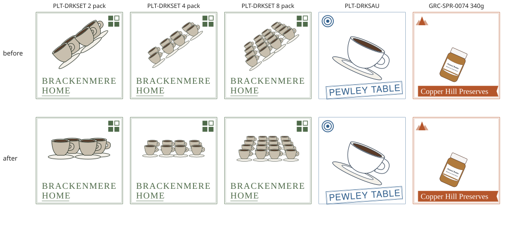

# Images

This is the README's images reference: what the drawings promise, where a record points, the
bundle, the image release, and the one renderer (moved out of the README, #701).

The picture and the drawing speed are at the [top of the README](../README.md#synthetic-ecommerce-data).

**One drawing per SKU, drawn from that SKU's own values, with no text in it but
its brand's name.** The rulings are on elastic/prism-industrial-products#103
(2026-09-26 to -28); the brand plate is #132 (2026-10-08).
How the code does it -- record to figure to SVG bytes, the registry, the
provenance ladder, the publish gate, and a checklist for adding a type -- is in
[docs/drawings.md](drawings.md).

**Exception: the [breadth categories](../README.md#catalog-breadth) draw one of seven
FIXED shapes** (sphere, cylinder, block, disc, tube, bracket and C-clamp, all drawn in code --
`domains/industrial/drawing/breadth_shapes.py`), never scaled or dimensioned from the SKU's own
published values. The "drawn from its own dimensions" rule above does not
apply to them: they are filler to give a facet something to show, not a
figure meant to survive a close look (maintainer, 2026-09-30). They still go
through the same text allow-list, brand plate, house style and material/finish fill as
every other drawing -- only the GEOMETRY is fixed. A breadth type with a drawing of its own
(30 so far, `drawing/breadth_products.py`, #1216) is drawn as the product it is sold as, lit and
filling at least half of the figure area ([drawings](drawings.md#breadth-types-fixed-shapes)).

* **One image per SKU**, so two lengths of one screw look different, and a
  grouped view can switch the picture when a variant is selected.
* **A brand plate under the figure** (#132): the brand's mark beside its
  name, in a strip at the foot of the sheet (`core/drawing/sheet.py`,
  `PLATE_BOX`). The figure is drawn in the sheet above it, so the plate never
  covers a dimension, a head or a thread of any type; an engineering
  drawing's maker sits in its title block the same way. Legible at the
  Studio grid tile (180 px for the 300-unit sheet, 0.6 px a unit): no
  name's capitals render under 10 px tall there. The full name is set beside
  the mark, on two lines beside it, split around it, or under it, whichever
  comes first at that size; a name none of them fits is refused, never
  shortened. The plate is 56 units tall, so the figure has the 236 units
  above it. Every SKU of a brand carries the same plate.
* **No other text** -- no dimension, callout, label or SKU.
  The words are on the record (title, description, attributes); the drawing
  reflects the specifications **visually**: a longer length of cut is drawn
  longer, a finer thread with more crests (a compressed rod or stud too: its
  crests are spread by one factor per diameter, so fine stays finer than
  coarse), a coolant-fed end mill shows its outlets, a flat head is a cone and
  a button head a dome, a sealed bearing is closed and an open one shows its balls.
  The gate is an **allow-list**, not a list of text forms
  (`drawing.svg_problems`):
  - every element must be one the figures emit (`svg, rect, defs, pattern, g,
    path, circle`, and the plate's `text`), and there is no nested `<svg>`;
  - the `<text>` elements' words, joined, must be a brand's wordmark, and
    the font attributes appear on `<text>` only;
  - every attribute must be one they use, and every attribute VALUE must fit
    its grammar: a paint is a color, `none` or a same-file hatch reference,
    never an external or `data:` URL;
  - every id is a hatch's (the background textures' `tgrid`, `tdot` are refused
    since #849); dasharray: book's only;
  - no element but `<text>` may carry character data;
  - no comment, processing instruction, doctype or entity reference may
    appear, but the `&amp;` of a name like `Lark & Lathe`.

  One thing no structural check can catch: a glyph's outline drawn as a plain
  path is indistinguishable from any other outline. The review's plants
  -- `<title>`, `<desc>`, `aria-label`, a comment, `<metadata>`,
  `<foreignObject>`, an embedded raster, `@font-face`, a glyph path from any
  font -- each red `tests/test_sku_drawings.py`.
* **Brands visibly different**, by house style and by mark: each brand owns
  one (ink, frame) pair -- twelve inks, four frames in use -- and one mark,
  consistent within a brand, never random per product
  ([Brands](../README.md#brands)). Every brand draws on the one paper, white,
  with no texture (#849): a tinted paper read as a search signal.
* **Products visibly different**: each product's figure is turned by its own
  angle, a hash of its product id over the angles its type's orientation allows
  (`core/drawing/product_look.py`, #849). Every SKU of a product shares it, so
  a product's variants still read as one product, and two products of one type
  from two brands no longer draw the same picture. Every type names one of
  five orientations (`domains/industrial/orientation.py` by type,
  `domains/retail/orientation.py` by drawn shape; a test refuses a type that
  names none). A retail shape's orientation sits in
  `domains/retail/orientations/<owner>.py`, named after the module that
  registers the shape (`kit_health.py` -> `health.py`, #1045), so PRs from
  two departments do not edit one list. `tests/test_orientation_owners_1045.py`
  refuses a shape filed in a module other than its owner's, and
  `scripts/check_no_registry_append.py` refuses a shape line added back to
  `orientation.py`. A product any SKU of which is a pack of several items (a cup
  set in 2, 4 and 8 packs, a card of end mills) is drawn `level` on every SKU
  whatever its type's orientation (#884): a turned group sits on a slant and
  overlaps. A single product keeps its tilt.

  | Orientation | Angles | For |
  |---|---|---|
  | `any` | the 24 clock positions, 0 to 345 in steps of 15 | a part with no natural up: screws, nuts, washers, pins, bar stock, discs, gloves |
  | `upright` | -36 to 36 in steps of 12 | a product with a natural up (a bottle, a vise, a light bulb); in retail only a small thing held, carried or worn (#1101) |
  | `slight` | -15 to 15 in steps of 5 | clothing and footwear, and what is worn with them (a belt, a scarf, a tie, a hat) |
  | `diagonal` | 54 to 66 to either side in steps of 6 | a wide, low industrial product the portrait sheet would draw small: safety glasses (#1217) |
  | `steady` | -6 to 6 in steps of 3 | a product drawn to fill the figure area, which a wider turn would shrink under half of it (#1216) |
  | `level` | 0 only | a set or kit type drawn as several items (cutlery, a dinner set, luggage, a bit socket set), every pack (#884), a bicycle (#1049), every furniture item, lamp, light fitting, garden furniture piece and crib (#1095), and every product the guard below holds level: a large appliance, a bike, a scooter, or anything over 60 cm (#1101) |

  

  A bicycle is `level` (#1049): it rests on its two wheels, so turned it reads as falling or
  doing a wheelie. Two road bikes, the smallest frame size of each, turned -24 and +24
  degrees before ([before](images/bicycle-level-1049-before.svg)) and level after
  ([after](images/bicycle-level-1049-after.svg)). The size, measured in the kit's units:
  level, each adult kind's full-size drawing spans most of the 344-unit figure area
  (`house_styles.TURN_AREA`): road 318, electric 312, mountain 376. A bike looked a third
  of the sheet wide because of three factors. The turn's fit-scale took it to 0.909 at 24
  degrees (as low as 0.707 at other angles). The size ladder draws the smallest of three
  frame sizes at 0.55 / 0.90 of full size. The house style scales the product to 0.86 or
  0.78. Slice 1 removed the first factor.

  Slice 2 (#1049) makes every bike SKU span at least 80% of the figure area. A bicycle has a
  size ladder of its own (`size_ladder.BOTTOMS`): its smallest frame draws at 0.74 / 0.90 =
  0.82 of full size, the middle one at 0.91 (the shared ladder: 0.61 and 0.81). The road,
  electric and kids drawings are widened to the figure area's 344 units at full size (the
  axles moved out, the kids' wheels a little larger), so the smallest frame spans 283 units
  (82%), the mountain bike's 309 (90%). Measured on all 492 bike SKUs, before: 300 under 80%,
  the smallest road frame at 56% and the smallest kids' bike at 45%; after: none.
  A dining table, a bookcase and a mirror have a narrower ladder too, 0.84 / 0.90 = 0.93
  ([furniture-fill-1214](retail-prototype/furniture-fill-1214.md)).
  Each size of one road and one kids' bike, before
  ([before](images/bicycle-fill-1049-before.svg)) and after
  ([after](images/bicycle-fill-1049-after.svg)).
  `tests/test_bicycle_level_1049.py` checks every SKU of every bike in the built catalogue.

  Every furniture item is `level` (#1095): the maintainer saw tilted beds in the R&I demo
  (2026-11-20), and a bed, sofa, table or wardrobe stands on the floor. Every shape of the
  furniture, seating, home furniture and storage furniture kits (a mirror and a bar stool
  included), the bed frame, the chairbed and the sofa moved from `upright` to `level`. Before,
  102 of the 124 products under Home > Furniture were turned (362 of their 450 SKU images, 13
  of the 16 beds); after, none. The Pine Panel and Upholstered bed frames, turned -36 and -24
  degrees before ([before](images/furniture-level-1095-before.svg)) and level after
  ([after](images/furniture-level-1095-after.svg)).
  `tests/test_furniture_level_1095.py` checks every SKU of every Home > Furniture product in the
  built catalogue.

  Slice 2 (#1095) moves the rest of what the issue counts to `level`: every lamp and light
  fitting (table, desk and floor lamps, ceiling, wall, vanity and outdoor lights), the
  lampshade, the coat stand, the garden furniture (sets, chairs, tables and parasols), the
  crib and the bench. A light bulb keeps its tilt. Before, 94 of the 134 products in those
  groups were turned (the mirror was already level); after, none. The same test checks every
  SKU of each of them.

  A guard beside the pack rule wins over the shape table (#1101,
  `orientation.level_because`). It draws a retail product `level` whatever its shape when its
  category is one that stands on the floor or on wheels (`orientation.NEVER_TILT`: Home >
  Furniture, garden and nursery furniture, Home > Large Appliances, bikes and exercise bikes,
  kick scooters, ride-on toys), or when it states a height or length over 60 cm
  (`orientation.MAX_TILT_CM`). The size is read from `item_height` and `item_length`, a SKU's
  `height_cm`, `length_cm` or `height` in feet, and each side of a `dimensions` value. A run
  length in metres (a cable, a hose) is not a size, because the item is drawn coiled. Before
  the guard, an unsure shape went to `upright`, so every fridge and washing machine was turned.
  On main d4e5232e, 100 of the 119 Home > Large Appliances products were turned. The guard
  levels 183 turned products: 100 large appliances, 3 kick scooters and 6 ride-ons by
  category, and 74 by size (rugs, throws, beach towels, bath mats, kayaks, snowboards,
  fishing rods, Christmas trees, scarves and the like). `tests/test_tilt_guard_1101.py`
  checks a recorded slice of the built catalogue (a sofa, a mountain bike, a fridge, a
  wardrobe and a glove): only the glove is turned.

  Tilt is opt-in in retail (#1101, slice 2). A shape that no `orientations/` module names is
  `level` (`orientation.of`), so a new shape is never turned by accident. Only a small thing
  you hold, carry or wear keeps `any`, `slight` or `upright`. Of the shapes in `upright`, 78
  were not held or worn, and each moved to `level` in its owner's module:
  - **Stands on the floor:** a heater, a tower or pedestal fan, a fridge, a dishwasher, the
    laundry machines, a high chair, a car seat, a pet bed, a planter, a potted or Christmas
    tree, a tent, a play kitchen, a dolls' house.
  - **Fixed in place:** to a wall, ceiling, car or plumbing, such as a wall clock, a ceiling
    fan, a tap, tiles, wallpaper or a seat cover.
  - **Used where it stands:** a mains appliance or screen, such as a TV, a monitor, a desktop,
    a printer, a soundbar, a toaster, a coffee maker or a blender.
  - **Laid flat or hung:** bedding, rugs, mats, throws and curtains.
  - **Vehicles and things on wheels:** a stroller, a suitcase, a skateboard, a kick scooter, a
    lawn mower, a toy car, a ride-on, a kayak.

  On main f53951d2, with the guard applied, 485 of the 752 products drawn with these shapes
  were turned; after the change, none. `tests/test_level_default_1101.py` lists the 78 shapes
  and checks each one.

  The retail build report audits what it tilts (#1101, slice 3). The report's `tilt` section
  (`tilt_audit.audit`) reads each product's drawn angle, `orientation.drawn_angle`, which is
  the angle the image is rendered at. It gives the products and turned products of each
  category, and the 20 turned items with the largest stated height or length. The build exits
  3, naming each product on stderr, when a turned product is in a never-tilt category or states
  a size over 60 cm. The audit reads the category and size itself, not through the guard, so a
  change that weakens the guard fails the build. On the retail ceiling (368,575 SKUs), 20,255
  of the 34,463 products are turned, in 685 of the 910 categories, and none is refused. The
  largest turned items are 60 cm: a foam roller, a floor puzzle, a snood and artificial stems.
  `tests/test_tilt_audit_1101.py` plants a turned fridge and checks that the build fails.

  Any two brands' marks, rasterised
  at the tile's 19 px, differ in at least 24 pixels
  (`tests/test_brand_marks.py`; the closest pair measures 25).
* **What every SKU of a product shares, and what is its own** (the maintainer's
  ruling on #860; `tests/test_one_look_per_product_849.py` checks all three
  over the golden catalog, the retail image release and the retail ceiling build):

  | Same for every SKU of a product | Per SKU |
  |---|---|
  | outline color, frame, brand mark and name, angle | fill = the SKU's own color; a named part's color (a cushion's blue trim) drawn on that part |

  A product with no color attribute (a screw) keeps its material or finish
  fill, so all its SKUs look alike except for the size.
* **A part longer than its type's extent is drawn BROKEN**, not shrunk: the
  shank is shortened between two drafting break lines, head and thread end
  kept, to a height that still grows with the true length. Each break line is
  a zigzag that the cut end follows, large enough to read at card size, so the
  part looks shortened rather than snapped ([Drawings](drawings.md)). The screw and bolt
  extents are the pre-100K ones, so one 14-5/8" outlier no longer draws every
  socket screw 2.5x smaller.
* **Finish and material** are the part's fill (the finish's color, else the
  bare material's) and its section hatch.
* **Small SVG**, written directly rather than through a figure library:
  about 2 KB a drawing. `figures.drawings` in `golden-catalog/stats.json` has
  the committed catalog's count, total and largest bytes and the largest's
  type; `uv run ecom-generate images --catalog golden-catalog --out /tmp/img
  --archive /tmp/img.tar.gz` prints them with the archive's size. Every root
  declares `width="200" height="300"` beside its viewBox: an `` sized only
  by max-width/max-height in a flex item that does not grow renders a
  viewBox-only SVG at 0 x 0.

The drawing is a pure function of `(product type, brand, published attributes)`
(`src/synthetic_ecommerce_data/core/drawing/`). For the six kinds
with a module in `domains/industrial/geometry/` (end mills, drills, taps, screws
and bolts, washers, flap discs) it reads the SKU's geometry through that module's
`geometry_from_record`, which parses and checks a record and draws nothing; the other depth types read their few values inline, and the breadth
shapes read none.

**Sizes are visible.** The scale is one constant per product type: sheet units
per inch are the usable sheet over the type's largest drawn extent, declared
per type in `domains/industrial/drawing/figures.py`. There is no exception to it: a part too
small to read is not drawn larger, it is shown through a **magnifier**
(maintainer ruling on elastic/prism-industrial-products#103, 2026-09-28):

* a part is **too small to see** when it is drawn at most 1/5 of the sheet's
  width (40 units) AND at most 1/6 of its height (50), and such a part ALWAYS
  gets a lens (the refined ruling of 2026-09-28, with the edge cases settled at
  1/5 wide so socket screws drawn just over 1/6 are lensed); every other part
  is drawn plain, centred;
* the lensed part is drawn at its type's scale near the bottom of the sheet,
  horizontally centred, with no circle around it, and the lens above it shows
  the same figure enlarged so its bounding box's diagonal spans 92% of the lens;
* the lens is a magnifying glass in the icon's shape (a ring, a thin shaft and a
  grip twice the shaft's width, round caps, the handle at 45 degrees to the
  bottom-right), stroked at 35% of the icon's weight in the brand's ink, when
  that glass enlarges the part at least 2.5 times; otherwise it is a larger
  HANDLE-LESS lens -- the same thin ring and white interior -- sized to the
  sheet's width at an 8-unit side margin (the smallest that clears every brand
  frame by at least a unit), or to the 236-unit figure area above the brand
  plate where that is tighter. It cannot grow further: at the rule's extreme
  (a part drawn 40 x 50) it is height-bound and enlarges only ~x2.05, below
  the x2.5 the handled glass guarantees;
* the whole glyph is horizontally centred and as large as fits; the space above
  it equals the space below the part, with a 14-unit gap between them;
* no outline is thinner than 2.3 sheet units (~2 px on a 180 px-wide
  thumbnail), so a hairline part -- a 1/16" drill is under one unit wide at its
  type's scale -- is visible with or without a lens. Interior detail lines
  (flutes, threads, hatch) are texture and keep their finer weight.

How many committed SKUs are too small to see, how many of them get the handled
glass and how many the handle-less lens, with each lens's enlargement range, is
what the command in [docs/drawings.md](drawings.md#scale-the-magnifier-and-the-only-text) prints. The
lowest enlargement any committed lens gives is x2.46, a width-bound
handle-less lens (below); no committed part reaches
the rule's 40 x 50 extreme. No drawing
carries text; the magnifier adds only paths and circles, and
`stroke-linecap="round"` to the allow-list.

What `tests/test_sku_drawings.py` proves over the committed catalog:

* **One scale per type.** Every product is drawn at its type's scale, so any
  two parts of a type are in true proportion, and a head, a thread or a bore
  siblings share is drawn identically on each (measured on the true-scale
  part of every drawing: screws' heads and bearings' outer rings).
* **The magnifier:**
  * a lens appears on exactly the SKUs drawn at most 1/5 of the sheet's width
    and 1/6 of its height, over every committed SKU;
  * the handle-less lens is used exactly where the handled glass cannot reach
    x2.5; the committed catalog's lowest enlargement is the `lens.min_enlargement` of `tests/data/golden_pins.json` (its
    measured minimum, rounded down), and the rule's extreme (40 x 50) at
    x2.05 to x2.5 -- below x2.5 because the lens is height-bound in the
    236-unit figure area above the brand plate (#132);
  * the handle-less lens clears the brand frame (8 units in, frames at 6 with
    strokes at most 2 wide);
  * each dimension binds on its own (planted: 41 x 5 and 5 x 50.5 plain,
    39 x 5 and 5 x 49 lensed); long thin parts never get a lens;
  * the lens shows the same part: the same shapes, scaled about the two
    centres by the layout's enlargement, and inside the lens;
  * the space above the glyph equals the space below the part, the gap is
    14 units, and the glyph and the part are centred, for both kinds of lens;
  * the ring, shaft and grip are in the brand's ink; the handle-less lens has no
    shaft or grip;
  * no outline, glyph stroke included, is thinner than 2.3 units (the hairline
    drill 93TD57, under two units wide, is pinned).
* **Other properties:**
  * no product exceeds its type's extent;
  * no drawing leaves its sheet;
  * no two siblings draw alike unless they differ only in values no figure
    draws.

An M3 washer's true-scale drawing is exactly 7/30 of an M16's diameter.

A record whose geometry cannot be read as published -- an attribute absent, a
value that does not parse, a pair that contradicts itself -- is drawn with its
kind's **nominal** proportions for the missing or conflicting values, and
`images.jsonl` says so per SKU (`geometry`: `record`, `partial` or `nominal`).
A drawing with no text states no number, so a nominal proportion cannot
contradict a published value; a consistent published value always wins.
`tests/test_sku_drawings.py` asserts the parts that are drawn from the record
are drawn to exactly its published length.

### Where a record points, and the bundle

Every SKU's `image_id` is `<product type>/<product id>/<sku>`; its `image_url`
is `/images/industrial/<image_id>.svg`, and `image_detail_url` names the same
file (one SVG serves both views). The exception is a pack on a
[package quantity](package-quantity.md) axis: its card fans its N items, and its
detail is its single's drawing. A product shows its first variant's drawing.
The URL is relative on purpose: the demo serves the bundle's folder itself
(elastic/prism#9770), and nothing points at a third-party host. That includes
the personal site of the write-up: it hosts only a small sample of the
drawings (a few hundred), so a demo takes the full set from the generator or
the release bundle and serves it itself.

```sh
uv run ecom-generate images --catalog golden-catalog --out out/images --archive out/images.tar.gz
```

rebuilds every drawing from the **committed** catalog (`nested.jsonl`, with each
SKU's published spelling read from `flat.jsonl`), refuses unless each one's
sha256 equals the one `images.jsonl` records, and writes the files and a
deterministic archive (sorted members, zeroed times and owners, a gzip header
without a timestamp).

**Layout.** Every member is `industrial/<type>/<product>/<sku>.svg`: the
archive carries its own top-level `industrial/` folder, so a customization
unpacks it into its images folder, the demo serves that folder at `/images`
(elastic/prism#9770), and `image_url` -- `/images/industrial/...` -- resolves
with no per-deployment mount. A test pins that every member is exactly its
`image_url` under `/images`.

**The pin is of the content, not the compressed bytes.** gzip output depends on
the zlib build, so the archive's own sha256 is only stable on one toolchain.
What a customization pins is the **content digest**: the sha256 of the sorted
`<member path>\t<file sha256>` lines, printed by `ecom-generate images` and
written beside the archive as `.content-sha256`. It is derivable from the
committed `images.jsonl` alone (`bundle.manifest_digest`), and the installer
recomputes it after unpacking. `out/` is ignored by git, and a test asserts it,
so a drawing can never be committed here.

```sh
uv run python scripts/contact_sheet.py --catalog golden-catalog --out out/contact-sheets
```

writes an HTML contact sheet of real catalog SKUs -- one screw across its
lengths for two brands, flat washers across sizes, materials and brands, and
twenty SKUs of every type -- for judging the drawings by eye.

### The image release: one set, one file per SKU

```sh
uv run python -m synthetic_ecommerce_data.domains.retail.image_release --out out/images --archive out/images.tar.gz \
    [--skus ceiling] [--industrial-catalog out/catalog-100k]
```

packages the combined catalog's drawings as ONE image set under ONE pin (gen#706): every retail
SKU's image, and with `--industrial-catalog` every SKU of that industrial catalog directory
(rebuilt and checked against its `images.jsonl`, as `ecom-generate images` does), in the
industrial bundle's shape, so the same installer takes it. Members are `retail/<image_id>.svg`
and `industrial/<image_id>.svg` in one archive, unpacked into one images folder; every
`image_url` is its member under `/images/`. The deterministic archive, the content digest and
the file count are printed and written beside it as `.content-sha256`.

**Every SKU has its own file.** A retail `image_id` is `<type>/<product>/<sku>`, as an
industrial one is. What the file draws is keyed separately (`export.drawing_id`): the style and
colorway, the pack scale (a smaller size of a line draws smaller, gen#543; see
[the pack scale page](retail-prototype/pack-scale-543.md); a loaf's crust and form, gen#1126, are on
[the bread page](retail-prototype/bread-1126.md)), the net volume of a hand-written drink, which is
its container (gen#1127, [the beer page](retail-prototype/beer-1127.md#hand-written-rows)), the pack count (a pack of N draws N
items, gen#728; see [the pack copies page](retail-prototype/pack-copies-728.md)), and for a type that declares a
size axis (`size_axes.AXES`) the size-ladder rung (`size_ladder.py`, gen#339, gen#719). SKUs that draw the same picture each get their own
copy of it, so one SKU's color, size or shape can change later without moving another's image.
The authored-styles build is `templates.authored` SKUs and files over `templates.authored_drawings`
distinct drawings (`retail_figures.figures()`); `--skus N` releases the scaled build instead
(`scale.py`'s).

**The release refuses a broken set** and writes nothing: a file two SKUs name, a SKU with no
file, or a file no SKU names (`bundle.sku_file_problems`), and a `drawing_id` that names two
different drawings. There is no committed manifest for the retail half (the retail build is
code, not a committed catalog), so the render is its source.
`tests/test_retail_image_release.py` and `tests/test_one_file_per_sku_706.py` pin the keying,
the one-file-per-SKU rule, that every document's image URL resolves to a packaged file, and the
package shape.

**Each image names what it was drawn from** (gen#924). Beside the archive, and in `--out`,
`drawings.jsonl.gz` holds one row per image file, sorted by `image_url`: `image_url`,
`image_id`, `product_id`, `sku`, `title` and `drawing`. A retail `drawing` is the colorway
drawing the file was rendered from: `shape`, the fill (`base`, `pattern`, `accent`), `params`
(a dress's `features`, a lamp's `finish`), and any `size_scale`, `pack_scale` or `pack_count`.
An industrial one is `core.drawing.drawing_spec`: the type's figure (`shape`), the part fill its
finish or material picks (`fill`) and the published values the figure reads (`params`). When an
image contradicts its title (gen#922), look the image up instead of re-deriving its drawing
from the templates. The lookup needs no cluster:

```sh
uv run python -m synthetic_ecommerce_data.domains.retail.image_release \
    --lookup /images/retail/dress/PLT-DPT105/PLT-DPT105-EF21AEB0.svg --drawings out/drawings.jsonl.gz
```

`--lookup` takes an `image_url` (an absolute URL matches on its path), a product id (every SKU
of it) or a SKU. The file is not an archive member: the archive holds one file per SKU, and its
count names the images release. `tests/test_drawing_manifest_924.py` pins that a retail row
re-renders its image byte for byte and that an industrial row redraws the recorded sha256.

A `v*` tag builds the retail ceiling and the industrial large build, composes them into one catalog, builds this bundle, uploads them to a release with their
`.content-sha256`, and prints their pins. It opens no pull request and needs no secret: v3's
catalogue load publishes and pins the images ([docs/releasing.md](releasing.md), gen#536, gen#1246); a manual run of the workflow is the dry run.

### One renderer

`domains/industrial/drawing/` is the only way a product is drawn, and its drawings carry no
text. The matplotlib renderers that put tables, stamps and callouts into a picture
(`domains/industrial/render/`, and the `sip-render` and `ecom-render` commands) were
retired in #27. What they shared with `drawing/` -- reading a record into measurements --
lives in `domains/industrial/geometry/`.
