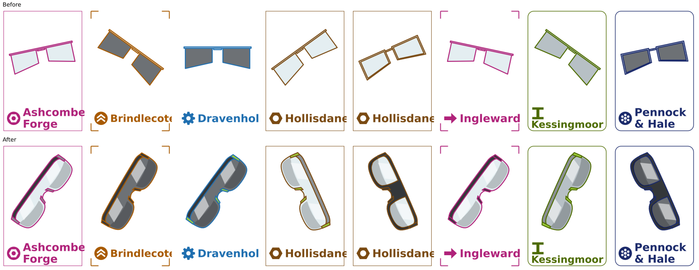

# Safety glasses: a type built from model lines (gen#834)

`safety_glasses` (`Safety > Eye Protection > Protective Glasses`) is a modelled type, deepened from its one-SKU breadth row. ANSI/ISEA Z87.1 rates a spectacle's impact protection and says nothing of its frame's size, so the type has no size table: it is the 44 model lines of a safety-eyewear maker's public product feed, each one frame style (`Style`: `Frameless`, `Half-Frame` or `Full-Frame`), lens coating (`Coating`: `Anti-Fog` or `No Anti-Fog`) and, on a framed pair, frame color (`Frame Color`). A product is one brand's pair of one model line, and its SKUs are a run of the lens colors that line is sold in (`Lens Color`: `Clear`, `Gray`, `Amber`, `Indoor/Outdoor Mirror`, `Silver Mirror`, `Blue Mirror`). The breadth row's one `Color` named the lens's tint; a pair also has a frame color, so the type publishes the two as `Lens Color` and `Frame Color`, both `names.NAME_EXCEPTIONS` rows. The module's docstring names the feed, the day it was read, the models and item numbers behind each line and what was left out (sealed, reader and over-the-glasses eyewear, polarized lenses, the less common tints). Every line claims ANSI/ISEA Z87.1 and publishes `Material: Polycarbonate`, the lens's material: the maker's pages state it for 24 of the 33 models and no other lens material for any, so for the other nine it is an inference. The price is the census's 74 pairs (`price.DEEPENED_CENSUS`), every lens color of one pair at one price; the anti-fog premium is a declared estimate. The drawing is the pair from the front, laid diagonally across the sheet (`diagonal`, [images.md](../images.md)) in its frame color and lens tint: a one-piece shield (`Frameless`), a shield under a brow bar (`Half-Frame`) or two lenses in rims (`Full-Frame`), with the temples' end pieces, the nose pads, a highlight and a shadow (#1217). A two-color frame (`Black/Lime`) takes its first color on the frame and its last on the end pieces and pads; a frameless pair's are clear. Over the 52 SKUs of the default build a pair fills 30-32% of the product area, where the old front view filled 16-22%. It cannot reach the 50% floor: a pair's front is 5.9 x 1.9 in, and a solid box of that shape covers 39% of the 164 x 200 area at its best angle. `tests/test_fill_safety_eye_1217.py` names the type with its own floor, 30%. `tests/test_type_safety_glasses.py` runs the per-type gates.

