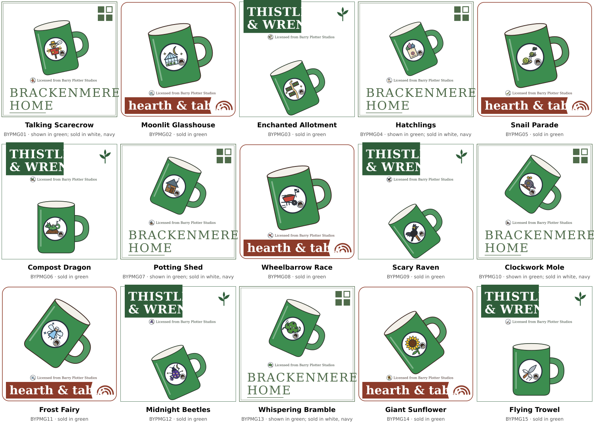

# Barry Plotter, an invented franchise range named only in the text (gen#925)

The invented kids' films ([kids-films-887.md](kids-films-887.md)) sell about 30 SKUs each, from
one brand at one price per type, so a film phrase with a filter (`under 30`, `age 8`, `on sale`)
leaves one product or none. Barry Plotter is large enough to filter. It is an invented
book-and-film series about a boy gardener and his enchanted allotment, sold in six groups by
fourteen existing houses at a value, a standard and a premium price
(`src/synthetic_ecommerce_data/domains/retail/barry_plotter.py`).

The name is a play on a famous name, and nothing else of the original appears. The range has 15
motifs of its own, one per design (the last seven added by gen#942):

- Talking Scarecrow
- Moonlit Glasshouse
- Enchanted Allotment
- Hatchlings (creatures that hatch from enchanted packets)
- Snail Parade
- Compost Dragon
- Potting Shed
- Wheelbarrow Race
- Scary Raven
- Clockwork Mole
- Frost Fairy
- Midnight Beetles
- Whispering Bramble
- Giant Sunflower
- Flying Trowel

No motif word is a product type, category, color, pattern or material word of the catalogue,
plural or not, so a motif never makes a product match a search for another kind.
`tests/test_barry_plotter_motifs_942.py` checks every motif word against the words of the
catalogue's types, category paths, colors, patterns and materials on the ceiling build, and
proves the check finds a planted `Stone Toad`. The check is why two proposed motifs were renamed:
*Whispering Hedge* (`hedge` is in the type Hedge Trimmer) became Whispering Bramble, and *Giant
Sunflower Seed* (`seed`, in the type Seeds) became Giant Sunflower. Titles stay
allotment-themed and away from the real films' titles. No description says "Barry's": the output
standard would read its "s" as the size S.

As with the films, the name lives only in the title and the description. Each product keeps the
brand of the house that makes it, carries no `product_line` and sits in the category of its
type, and no attribute names the range (`barry_plotter.structured_names`). Every description says
the product is "from the Barry Plotter films".

## The range

Counted on the `--skus ceiling` build (`tests/test_barry_plotter_925.py` checks these figures):

| Group | Types | Brands | Products | SKUs |
|---|---|---|---|---|
| Building sets | building set | Pipwick Toys | 75 | 75 |
| Kids' clothing | tee, sweatshirt, hoodie, pyjamas, fleece all-in-one | Little Fernby, Wrenfield, Larkmoor, Pipwick Toys, Puddlecombe Toys, Quillon Sleep | 75 | 368 |
| Adult clothing | tee, pullover hoodie, knitted jumper, lounge joggers, socks | Harbour & Pine, Larkmoor, Wrenfield, Calderby & Lune | 75 | 345 |
| Accessories | backpack, lunch box, drinks bottle, beanie, knitted scarf | Larkmoor, Harbour & Pine, Hearth & Table, Little Fernby, Brackenmere Home, Wrenfield | 75 | 150 |
| Home | mug, duvet set, cushion, star night light | Brackenmere Home, Hearth & Table, Thistle & Wren, Little Fernby, Quillon Sleep, Lanternby, Calderby & Lune, Puddlecombe Toys | 60 | 105 |
| Party and stationery | party bags, paper party cups, birthday cake, A5 notebook, sticker sheets | Lanternby, Thistle & Wren, Cobble & Kiln, Crofter's Bakehouse, Hearth & Table, Calderby & Lune, Little Fernby, Pipwick Toys | 75 | 90 |
| **Total** | | | 435 | 1133 |

Each type sells one product per motif. The motifs take the value, standard and premium price in
turn and the type's houses in turn, so `barry plotter hoodie` lists products from several brands
at several prices:

| Type | Prices (value, standard, premium) | Sizes |
|---|---|---|
| Kids' tee | £7, £10, £14 | 3-4 to 9-10 Yrs |
| Kids' sweatshirt | £18, £24, £32 | 3-4 to 9-10 Yrs |
| Kids' hoodie | £22, £30, £36 | 3-4 to 9-10 Yrs |
| Kids' pyjamas | £16, £22, £30 | 3-4 to 9-10 Yrs |
| Kids' fleece all-in-one | £22, £30, £36 | 3-4 to 9-10 Yrs |
| Adult tee | £16, £24, £32 | XS to XL |
| Pullover hoodie | £30, £40, £55 | XS to XL |
| Knitted jumper | £32, £38, £48 | XS to XL |
| Lounge joggers | £26, £32, £40 | XS to XL |
| Socks, pack of 3 | £6, £8, £12 | S/M, M/L, L/XL |
| Backpack | £24, £34, £45 | |
| Lunch box | £6, £9, £14 | |
| Drinks bottle | £8, £12, £18 | |
| Beanie | £8, £12, £16 | One Size |
| Knitted scarf | £14, £20, £30 | |
| Mug | £7, £10, £14 | |
| Duvet set | £25, £38, £105 | |
| Cushion | £16, £24, £32 | 45 x 45cm |
| Star night light | £12, £18, £24 | |
| Party bags | £4, £6, £8 | |
| Paper party cups | £3, £4, £6 | |
| Birthday cake | £14, £20, £32 | |
| A5 notebook | £4, £7, £12 | |
| Sticker sheets | £3, £4, £5 | |

The building sets come in five piece counts per motif, each a SKU of its own: 60 pieces (ages 4
and up, £4.99 to £6.99), 220 (6 and up, £12.99 to £16.99), 520 (8 and up, £24.99 to £34.99),
1,100 (12 and up, £44.99 to £59.99) and 2,500 (adult builders, £99.99 to £149.99).

Clothing comes in several colors, so a color filter on the range still returns results. The
kids' hoodies sit in a leaf of their own, Kids > Tops > Hoodies. The issue named a few kinds no
type of the catalogue sells: pencil cases, posters and dressing-up costumes are left out, a
onesie is the All-in-One type, lounge pants are Joggers, a bottle is the Travel Cup type (titled
"Drinks Bottle") and a cap is a beanie of the Hat type.

## The emblem and the licence line (gen#928)

Every product of the range prints its motif's emblem and carries a licence line beside its
maker's logo, the same way each film product does
([kids-films-887.md](kids-films-887.md#the-emblems-gen904)). Without it, a range T-shirt looked
like any other T-shirt of its house. With it, a `barry plotter` search shows its hits belonging
together.

- **One emblem per motif (gen#942).** Under gen#928 the 8 motifs shared one emblem, so
  `green barry plotter cup` showed the same mug once per motif: the titles differed, the pictures
  did not. Each motif now prints its own badge (`barry_plotter_emblems.PICTURES`), the films'
  round badge, a white disc in a dark ring, showing the motif's creature or scene as one large
  subject: a scarecrow with a speech bubble, a glasshouse under a crescent moon, raised beds and a
  winding path, three creatures climbing out of a seed packet, three snails with glowing shells,
  a dragon asleep on a compost heap, a crooked shed, a racing wheelbarrow with a checkered flag, a
  black raven on a fence post, a mole with a cog and a wind-up key, a fairy with frost wings, a
  violet beetle with glowing spots under the moon, a bramble bush with a face, a sunflower, and a
  trowel with wings.
- **Barry in the corner.** Every badge has Barry, the kid gardener of gen#928, small in a white
  inset at its lower right (`barry_plotter_emblems.barry_corner`): round-rimmed glasses and
  tousled dark hair, which the maintainer allowed because both are generic. The 15 badges still
  read as one franchise. Nothing else from the original appears: no scar or lightning shape,
  robe, pointed hat, wand, owl, scarf or tie in house colors, castle or train. The drawings are
  original, in SVG paths.
- **The licence line** reads "Licensed from Barry Plotter Studios" on every motif.
- **Where it prints.** `film_emblems.PLACES` has a place for each of the range's 22 shapes. Twelve
  of them were new with gen#928: the all-in-one, backpack, building set, cushion, hat, hoodie,
  joggers, notebook, scarf, socks, star night light and travel cup. A pack of socks prints the
  badge on each sock it draws. A shape with no place fails the build.
- **One choice.** `film_emblems.emblem_of_id` chooses the emblem: a film's products get their
  film's, and a range product gets its motif's (`barry_plotter.MOTIF_OF`). The preview and the
  image release both draw through it.

The 15 stoneware mugs above are drawn in green by the image release. The range's color rotation
sells 10 of them in green; the other 5 (Talking Scarecrow, Hatchlings, Potting Shed, Clockwork
Mole, Whispering Bramble) come in white and navy and are shown in the green swatch's color.

`tests/test_barry_plotter_emblem_928.py` reads every one of the range's 1,133 SKU images and finds
its motif's emblem on the product, once in the licence line, and no film's emblem. It also checks
that every film SKU still carries its own film's emblem. `tests/test_barry_plotter_motifs_942.py`
renders one mug per motif and finds 15 distinct badges. It also bounds every point of each
badge's drawing, with the outline, inside the disc's ring.

## What a filter on the range returns

Each figure is a count of SKUs, the hits of an ungrouped search:

| Filter on the range | SKUs | Asked for |
|---|---|---|
| under £30 | 664 (59%) | 150 or more, about 60% |
| on sale | 285 (109 of 435 products, 25%) | 80 or more, about 25% |
| hoodies | 143, from 6 brands | 15 or more, from 3 brands or more |
| kids' pyjamas in 7-8 Yrs | 30 | 10 or more |
| building sets under £50 | 55 | 15 or more |

A quarter of the range is on sale, against about 8% of the catalogue. The range takes no
department's share: one product in four of each type is reduced, in a pass of its own
(`barry_plotter.SALE`, `barry_plotter.on_sale`), and the department sale passes leave it out.

## What a search meets

- **The name is in the title and description only.** Five products name it in the description
  only (`barry_plotter.DESCRIPTION_ONLY`): the Talking Scarecrow kids' pyjamas, pullover hoodie,
  mug, A5 notebook and 60-piece building set. A search can rank a description-only match against
  a title match.
- **Words the range shares with the rest of the catalogue:**

  | Word | What the rest of the catalogue holds |
  |---|---|
  | `barry` | No other product. It is one letter from `berry`, so a spelling corrector may rewrite it. |
  | `berry` | A word of eight other products' text in the templates (five meads, oranges, a cake, a body mist), and inside a word of many more (strawberry, raspberry, blueberry). |
  | `plotter` | No other product: the catalogue sells no pen plotter. |
  | `plot` | Fenwold Nursery's "Plot" garden series, derived in the scaled builds (plants, trees, bulbs: "Fenwold Nursery Plot Woolly Thyme Plant"). A stemmer that takes `plotter` to `plot` meets them. |

  Phrase matching has to keep the name together: elastic/prism-retail-and-industrial gets a
  special-phrase row for it (filed with this issue).
