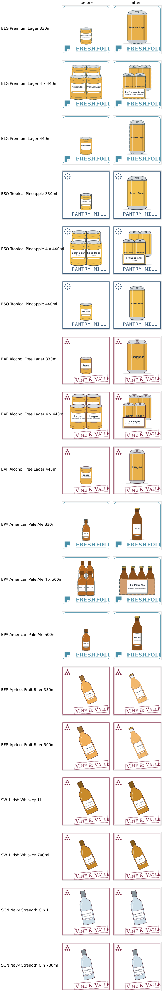
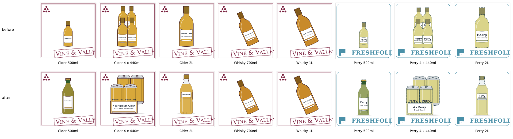
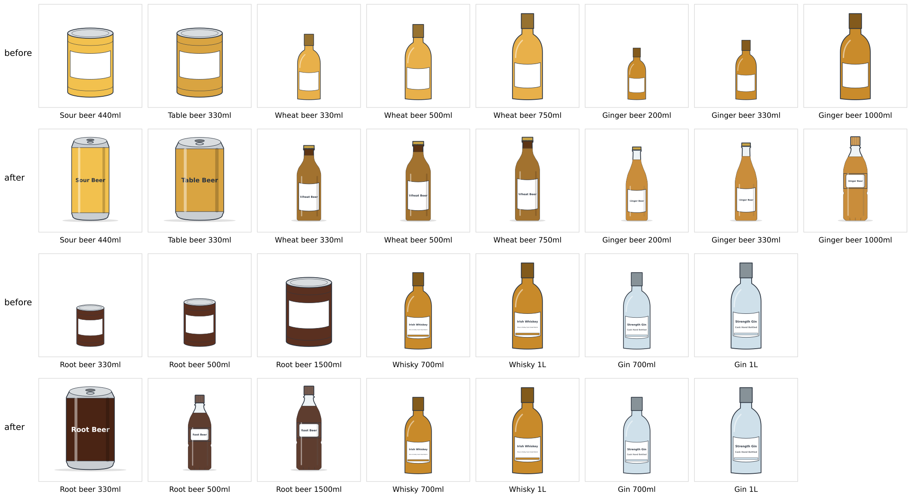

# Beer drawn as its real can, bottle or 4-pack (gen#1127, slice 3)

Before gen#1127 a lager, sour beer or alcohol free beer (BLG, BSO, BAF) drew the generic `tin`,
and a pale ale or fruit beer (BPA, BFR) the generic `bottle`, each shrunk by `pack_scale`
(gen#543). A 330ml can covered about a fiftieth of the product area, and a 4 x 440ml was four
copies of that one tin. The five families now draw `beer` (`kit_beer.py`): 147 products, 414
SKUs. Wine is slice 1 ([the wine bottle page](wine-bottles-1127.md)) and soft drinks slice 2
([the soft drinks page](soft-drinks-1127.md)). Cider and perry draw `beer` too
([below](#cider-and-perry)), and so do the beers written by hand
([below](#hand-written-rows)).

The figure draws one product of each family and pack on the plain sheet, before and after. The
whisky and gin keep `bottle`, unchanged. The Vine & Valley brand leans its bottles, before and
after.

**The container is the pack's own.** Each SKU draws its own `pack_size`, and its line says what
it is sold in (`grocery.BEER_LINES`: `sold_in` and `glass`, per-SKU drawing params).
`kit_beer.container` reads the pack:

| pack | container |
|---|---|
| 330ml, 500ml, 750ml in a bottle line (BPA, BFR; 750ml in a [hand-written row](#hand-written-rows)) | a glass beer bottle: crown cap on a bead, long neck, label, the beer through the glass (`kit_beer.GLASSES`: a pale ale in brown glass, a fruit beer in clear) |
| 330ml, 440ml in a can line (BLG, BSO, BAF); a 440ml anywhere | a ring-pull can printed in the beer's color (`kit_soft_drinks.can`) |
| N x 440ml | N cans in two rows under a card carrier (`kit_soft_drinks.multipack`) |
| N x 500ml in a bottle line | N bottles in a row in a card basket printed with the label |
| 1L or more in a bottle line (a cider's 2L) | a PET bottle (`kit_soft_drinks.bottle`): screw cap, petaloid foot, the drink through its clear wall (`kit_beer.PET_FROM`) |

Sizes are real (height, diameter) in mm: a can's from `kit_soft_drinks`, a bottle's from
`kit_beer.BOTTLES` (330ml 205 x 64, 500ml 245 x 75, 750ml 290 x 83). The beer's color is its flavor's (a lager
gold, a fruit beer in its fruit). `kit_soft_drinks.bottle` takes the glass's `wall`, how much of
the beer it `hides` and the bottle's `shape`; its defaults draw a soft drink as before.

**The size.** A bottle follows the wine bottle's rule: the line's largest single bottle (the
`largest` param) spans `FULL_SHARE` 0.97 of the product area's height, and a smaller one steps
down by its real height ratio to the power `STEP_POWER`, never below `MIN_SHARE` 0.8 of it. A can
stands at the full height, and a 4-pack fills the area's width. No `pack_scale` factor applies
(`pack_scale.SELF_SIZED`), and the 4-pack draws its own count, so `pack_copies` lays out no
copies (`pack_copies.SELF_DRAWN_SHAPES`). The pack copies strip
([the pack copies page](pack-copies-728.md)) showed an ale and a lager as copies; it now shows
chickpeas and baked beans, two tins that still take copies.

**Measured**: the cover of the product area (`house_styles.TURN_AREA`, `sheet_cover`, its ground
shadow left out) and the drawing's height span, as the wine page measures them.

| pack | before cover | after cover | after height span |
|---|---|---|---|
| 330ml can (BLG, BSO, BAF) | 0.020 | 0.502 | |
| 440ml can | 0.022 (BFR 0.247-0.269) | 0.392 | 0.96 |
| 4 x 440ml cans | 0.056 (one tin; served as 4 copies) | 0.677 | |
| 330ml bottle (BPA, BFR) | 0.093 (BFR 0.201-0.220) | 0.214 | 0.91 |
| 500ml bottle | 0.104 (BFR 0.269) | 0.235 | 0.96 |
| 4 x 500ml bottles (BPA) | | 0.653 | |

**Where it covers less than the gate asked.** The gate on gen#1127 asked for a can at 0.50 or
more and no SKU below its old cover. Two packs fall short, and both follow the 2026-11-15
ruling that the figure draws what the product states, at its real proportions:

- A 440ml can covers 0.39: it is a real 66 x 148 mm can drawn at the full height, so it is
  narrower than a 330ml.
- A fruit beer's 500ml bottle covers 0.235 where main had 0.269, and its 330ml 0.214 where main
  had up to 0.220. Main's generic bottle was about half again as wide as a real beer bottle.

`tests/test_beer_1127.py` pins a 330ml can and a multipack at 0.50 or more, a 440ml can at 0.38
(`TALL_CAN`) and a bottle at 0.20 (`BOTTLE`). It also pins the largest bottle's height span at
0.95 or more and a smaller one's at 0.95 x 0.8, a multipack's count of cans or bottles with no
copies, each line's cans or bottles and its glass, and that a beer takes no `pack_scale` factor.

## Cider and perry

Before, every Cider (CDR) and Perry (PRY) SKU drew the generic `bottle`: its 500ml shrunk by
`pack_scale` to 0.63 of the height, and its 4 x 440ml four copies of that bottle, not cans. Both
families now draw `beer` as bottle lines in green glass (`grocery.BEER_LINES`): 42 products, 126
SKUs. A 500ml is a green crown-capped bottle with the cider showing through the glass. A 2L is
the soft drinks' PET bottle, the line's largest single, so it spans the full height and the
500ml steps down under it. A 4 x 440ml is 4 ring-pull cans under a card carrier, printed in the
cider's color.

The figure draws one cider, one perry and one whisky on the plain sheet: before (main 703b459d)
and after. The whisky keeps `bottle`, unchanged.

| pack (CDR, PRY) | before cover | after cover | after height span |
|---|---|---|---|
| 500ml green bottle | 0.104 | 0.196 | 0.88 |
| 2L PET bottle | 0.269 | 0.235 | 0.97 |
| 4 x 440ml cans | 0.269 (4 bottle copies) | 0.677 | |

**Where it covers less than before.** The 2L covers 0.235 where main had 0.269: main's generic
bottle was about as wide as a 3L, and a real 2L PET bottle is 105 x 335 mm. That follows the
2026-11-15 ruling that the figure draws the product's real proportions, as the fruit beer's
bottle does above. `tests/test_beer_1127.py` pins a PET bottle at 0.23 (`PET`), a bottle that
steps down under its line's larger one at 0.19 (`STEPPED`), and each cider and perry 4-pack's 4
cans and carrier.

## Hand-written rows

The rows of `class_rows.py` (class 10, "beer") are styles written by hand, outside the grocery
build, so they kept the generic `tin` and `bottle`: a root beer's 1.5L was a tin. Five of them now
draw their real container: the sour beer (`PLT-BRTROP`), table beer (`PLT-BRTABL`) and wheat beer
(`PLT-BRWHET`) draw `beer`, and the ginger beer (`PLT-GNGBER`) and root beer (`PLT-RTBEER`) draw
`soft_drink`. That is 11 SKUs. The battered haddock and chips, and the beer bread, of the same
class are food and are unchanged.

Such a row states its size as `net_volume_ml` (or one `unit`), not as a `pack_size`, so both
shapes take a `net_volume_ml` param, which `kit_drinks.pack_of` reads as the pack. A row of one
size states its `pack_size` itself. A row's `largest` and, for a bottled beer, its `sold_in` and
`glass` are params of the row. Each row also states its `label`, which is now written on the
container: before, the label was blank.

The figure draws all 11 SKUs, a whisky and a gin on the plain sheet: before (main f30d5748) and
after. The whisky and gin keep `bottle`, unchanged.

| row and size | before shape, cover | after container | after cover | after height span |
|---|---|---|---|---|
| BRTROP 440ml | tin, 0.048 | can | 0.392 | 0.96 |
| BRTABL 330ml | tin, 0.048 | can | 0.502 | 0.96 |
| BRWHET 330ml | bottle, 0.154 | brown glass bottle | 0.194 | 0.87 |
| BRWHET 500ml | bottle, 0.201 | brown glass bottle | 0.213 | 0.92 |
| BRWHET 750ml | bottle, 0.269 | brown glass bottle | 0.217 | 0.96 |
| GNGBER 200ml | bottle, 0.093 | clear glass bottle | 0.158 | 0.85 |
| GNGBER 330ml | bottle, 0.126 | clear glass bottle | 0.173 | 0.90 |
| GNGBER 1L | bottle, 0.269 | PET bottle | 0.214 | 0.97 |
| RTBEER 330ml | tin, 0.018 | can | 0.502 | 0.96 |
| RTBEER 500ml | tin, 0.023 | PET bottle | 0.183 | 0.86 |
| RTBEER 1.5L | tin, 0.048 | PET bottle | 0.224 | 0.97 |

A tin's before figure is low by the method: `sheet_cover` reads no arc, and a tin's outline is
drawn with arcs. The generic tin at full size covers 0.373, so the sour beer and table beer, which
took no shrink, gain less than the table shows.

**Where it covers less than before.** The wheat beer's 750ml and the ginger beer's 1L filled the
frame as the generic bottle (0.269) and cover less at their real proportions, by the 2026-11-15
ruling above. So does the root beer's 1.5L: the squat full-size tin it was drawn as covers 0.373
with its arcs counted, and a real 1.5L PET bottle 0.224. `tests/test_hand_drinks_1127.py` pins each size's container, its floor, its color
and label, and that no row takes a `pack_scale` factor.
