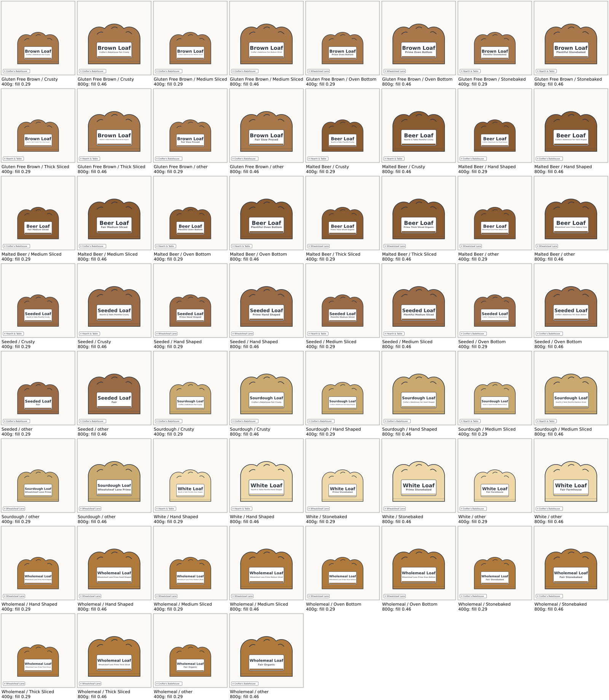
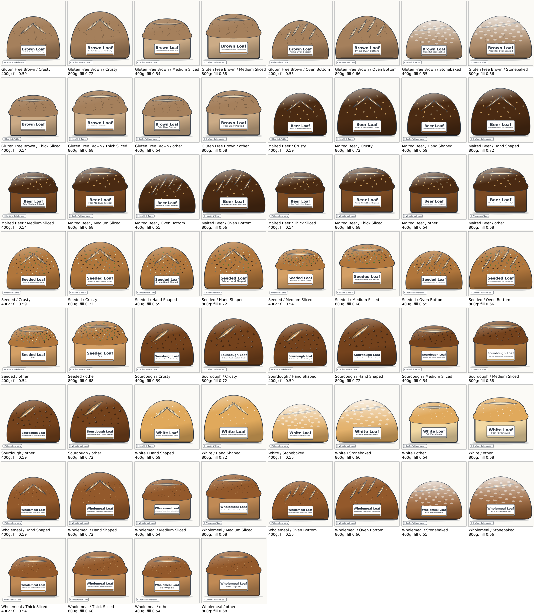

# Bread drawn as bakery loaves (gen#1126)

Before gen#1126 every bread SKU was one flat `kit.loaf` outline in its line's colour: the same
shape for a sourdough and a sliced white, covering 0.29 of the product area at 400g and 0.46 at
800g. A loaf is now drawn by `kit_bread.loaf` from two things the row already names:

- its **crust** (`kit_bread.CRUSTS`, keyed by the line's flavour): a colour and a texture of its
  own. White is pale golden with a dust of flour, Wholemeal brown with bran flecks, Seeded
  carries its seeds, Sourdough is dark and blistered with a scored ear, Malted Beer is dark and
  glossy with malt flakes, and Gluten Free Brown is matt and crackled;
- its **form** (`kit_bread.FORMS`, read from the line's own word by `kit_bread.form_of`):

| line word | form |
|---|---|
| Thick Sliced, Medium Sliced | a tin loaf for now; its bag is slice 2 |
| Hand Shaped, Crusty | a round boule with crossed slashes |
| Oven Bottom | a flat-bottomed loaf with diagonal slashes |
| Stonebaked | a wide loaf under a flour dusting |
| Farmhouse, or no word | a tin loaf: a domed crown over paler tin-baked sides |
| no word, Sourdough | a boule, as a bakery sourdough is hand shaped |

Every loaf carries a highlight up top and a shade below (`kit_bread.GLOSS`) and stands on a
ground shadow, with a small label sticker for the range name and flavour band. `grocery._drawing`
passes the flavour and form as marks; `PLT-BRB` (`class_rows`) and the sample "Seeded
Wholemeal Loaf 800g" name theirs as drawing params.

**A 400g loaf is drawn at 0.9 of its 800g** (`pack_scale.SHAPE_FLOORS`, see
[the pack scale page](pack-scale-543.md)). At the cube root (0.79) a 400g loaf covered under half
the product area; 0.9 keeps it visibly the smaller loaf and above the floor.

**Fill is measured against the product area**, the plain sheet's 344 x 334 box
(`house_styles.TURN_AREA`), with the sheet, frame, brand tag and ground shadow hidden
(`sheet_cover.cover`), on the served image (`image_release.render`).

| SKUs (68 lines, 135 SKUs) | before | after |
|---|---|---|
| every bread line, 400g | 0.29 | 0.54 to 0.59 |
| every bread line, 800g | 0.46 | 0.66 to 0.72 |

`tests/test_bread_fill_1126.py` reads the served SVG only. It holds that the build sells every
crust at 400g and 800g, that every bread SKU fills at least half its product area, that the 800g
is drawn larger than its 400g at 0.9, that each of the six crusts has its own colour and
texture, and that each form draws its own outline with a highlight and a shade.

Slice 2 (open): a sliced line is drawn as slices in a printed bag with a window and a clip.

Before (one crust x form x pack per cell, captioned with its fill):

After slice 1:

