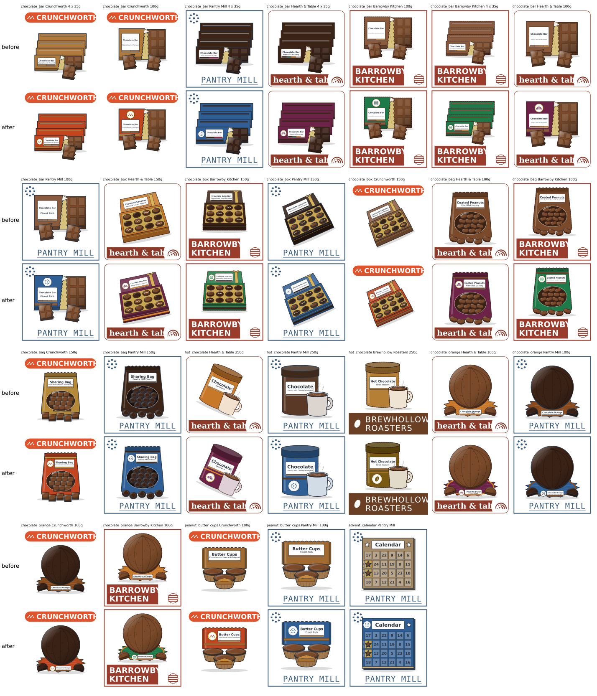

# Chocolate bars, boxes and bags that fill their picture (gen#1125)

Before gen#1125 every chocolate bar was the grocery kit's generic `bar`: a flat wrapper in the
flavour's color covering about a fifth of the product area at 100g, with the chocolate seen
only in a torn corner. A chocolate box was a closed, shallow box low in the frame (18% of the
product area at 150g), and a sharing bag the generic grocery bag (33% at 150g); neither showed
a chocolate. Slice 1 draws the bars and the multipacks, slice 2 the boxes and the sharing bags,
slice 3 hot chocolate and the chocolate orange, and slice 4 the peanut butter cups, the coated
peanuts, the advent calendar, the box of cherries and the bags of coated fruit. The last
slice prints each pack in its brand's color with its mark (below).

**`kit_chocolate.chocolate_bar`** draws a bar seen from a little above: its wrapper torn back
over gold foil to show the segmented block, the block glossed (a `choc-gloss-<hex>` gradient, a
highlight at the top left and a shade at the foot right), and two broken pieces in front, each
a `<g class="chocolate">`. The bar stands on a `class="ground"` shadow.

- **The wrapper is its brand's color (the flavour's with no brand, below), the block is chocolate.** The block and the pieces are
  painted the chocolate the flavour is made of (`kit_chocolate.CHOCOLATE`: milk, dark, white),
  so a Mint Dark bar is dark chocolate in a green wrapper and a Chocolate Orange milk chocolate
  in an orange one. `grocery_families.chocolate_of` reads the kind from the flavour, the white
  or dark its name says, else milk when it contains milk; it also files the bar under its
  Chocolate Bars child (gen#298). The grocery build passes it as the drawing's `chocolate`
  param, and the decoy dark and white bars name theirs. With no param the bar reads its kind off
  the base color's luminance.
- **A pale wrapper stays visible.** `kit_chocolate.wrapper_color` moves a wrapper towards a cocoa
  brown just far enough to keep a 3:1 contrast against white paper, so a white chocolate bar's
  cream wrapper does not vanish.
- **A bar shows its own weight.** A bar under 200g is drawn smaller by about the cube root of its
  weight, never under 0.9 of the full bar, and each SKU draws its own pack size
  (`export.drawing_spec`), so a 100g bar is smaller than a 200g one. The pack scale (gen#543)
  gives the shape no factor (`pack_scale.OWN_SIZE`).
- **A multipack is a stack of its bars.** "4 x 35g" draws four bars and "6 x 25g" six, each a
  `<g class="bar">`, the front one opened; pack copies (gen#728) leave it as it is
  (`pack_copies.SELF_DRAWN_SHAPES`). Its broken piece sits high enough on the front bar that
  the stack, the piece and the shadow stay on the 400 x 400 sheet (gen#242).

The cereal bars (`CBR`) keep the generic `bar`.

**Fill is measured against the product area**, the plain sheet's 344 x 334 box
(`house_styles.TURN_AREA`), by `sheet_cover.cover`, as gen#1111 measures produce; the ground
shadow does not count.

| pack | floor | measured |
|---|---|---|
| 100g | 0.50 | 0.60 |
| 175g | 0.50 | 0.66 |
| 200g, or no pack size (a decoy row) | 0.50 | 0.72 |
| 4 x 35g | 0.50 | 0.66 |
| 6 x 25g | 0.50 | 0.68 |

## Boxes and sharing bags (slice 2)

**`kit_chocolate.chocolate_box`** (GRC-CHX) draws an opened gift box seen from a little above:
the lid stands behind it, with a ribbon, a bow and the label panel, and the gold tray holds the
chocolates in brown paper cups. The assortment cycles a round truffle in the box's chocolate, a
square praline in a second one (dark in a milk box, milk in a dark or white one) and a dome
with a drizzle of a third, each a glossed `<g class="chocolate">`. A 150g box holds 4 x 3, a
250g 5 x 3 and a 400g 6 x 4.

**`kit_chocolate.chocolate_bag`** (GRC-CSB) draws a stand-up sharing bag: a crimped top seal, a
sheen down its left side, the label panel, and an oval window showing the pieces it holds,
with five more spilled at its foot. The grocery build passes `piece`: `buttons` (a disc with a
raised rim) when the flavour names buttons, else `bites` (a small block).

Both are drawn about the product area's center, so a house-style turn keeps them large, and
both draw their own weight: a box under 400g or a bag under 250g by the cube root of its
share, never under 0.84 (box) or 0.9 (bag), so `pack_scale.SELF_SIZED` gives them no factor.
The box and the bag are the flavour's color moved towards cocoa as far as white paper needs
(`wrapper_color`), so a white chocolate bag stays visible. The chocolate is the one the flavour
is made of (`grocery_families.chocolate_of`), passed as `chocolate`, as for the bars.

| pack | floor | measured |
|---|---|---|
| box 150g | 0.50 | 0.56 |
| box 250g | 0.50 | 0.58 |
| box 400g, or no pack size | 0.50 | 0.79 |
| sharing bag 150g | 0.50 | 0.59-0.61 |
| sharing bag 250g, or no pack size | 0.50 | 0.72-0.73 |

## Hot chocolate and the chocolate orange (slice 3)

Before this slice hot chocolate was a plain `jar` (GRC-HOT: 27% of the product area at 250g,
37% at 400g) or `tin` (PLT-HCORNG: 41%), with no cocoa in sight. The chocolate orange (GRC-CHO)
was drawn as a bar.

**`kit_chocolate.hot_chocolate`** (GRC-HOT, PLT-HCORNG) draws a lidded tub of drinking
chocolate in the flavour's color, with a sheen down its left side and the label panel. In front
of it stands a mug filled with the drink: a glossed `<g class="chocolate">` of the chocolate it
is made of, with a swirl on top and steam above.

**`kit_chocolate.chocolate_orange`** (GRC-CHO) draws a ball of segments in the chocolate it is
made of, glossed. Its grooves run from the top pole, the peel's dimples are pressed into it, and
it sits in its opened foil (the flavour's color) with two loose segments in front. The label
panel is on the foil.

Both are drawn about the product area's center and draw their own weight, by the cube root of
its share: a tub under 400g and an orange under 175g, never under 0.9. `pack_scale.SELF_SIZED`
gives them no factor. The tub and the foil go through `wrapper_color`, as the bars do.

| pack | floor | measured |
|---|---|---|
| hot chocolate 250g | 0.50 | 0.61 |
| hot chocolate 400g, or no pack size (PLT-HCORNG) | 0.50 | 0.74 |
| chocolate orange 100g | 0.50 | 0.59 |
| chocolate orange 175g, or no pack size | 0.50 | 0.73 |

`tests/test_chocolate_fill_1125.py` pins the floor over every bar, box and bag flavour and pack,
the gloss, the multipack's bar count and a box's chocolates by its size, that every pack stays
on its sheet, the wrapper's contrast, the chocolate of each style, the bag's pieces, and that
each SKU draws its own pack size. It pins the same over every hot chocolate and chocolate orange
flavour and pack, and PLT-HCORNG, together with the mug and its lid, and a dark orange drawn in
dark chocolate and a milk one in milk.

## Peanut butter cups, coated peanuts, the advent calendar, cherries and coated fruit (slice 4)

Before this slice the peanut butter cups and the coated peanuts (GRC-PNT) were drawn as a bar,
the chocolate advent calendar (BRD-SEAADV) and the dark chocolate covered cherries (PLT-DXQ42)
as the generic closed `box` (52% of the product area, no chocolate in sight), and the chocolate
covered strawberries and bananas (PLT-DXQ19, PLT-DXQ39) as the generic grocery `bag` (47%).

**`kit_chocolate.peanut_butter_cups`** (the PNT flavour Chocolate Peanut Butter Cups, through
`grocery.SHAPES`) draws the opened wrapper lying behind, in the flavour's color with its
crimped ends and label panel, two fluted cups standing before it and a third in front, cut to
show its peanut butter filling. Each cup's top is the chocolate it is made of, glossed. A pack
under 200g draws itself smaller, never under 0.9; `pack_scale.SELF_SIZED` gives it no factor.

**`chocolate_bag`** takes three more pieces: `peanuts` (the PNT flavour Chocolate Coated
Peanuts, whose bag `grocery` gives that piece by its name), `strawberries` (a coated berry, its
red tip and leaves showing) and `bananas` (coated banana coins, one broken open on its cream
face). The decoy rows draw them through new kinds in `decoy_rows.KINDS`:
`coated_strawberries` and `coated_bananas` (milk chocolate, in the Sweets aisle as before) and
`chocolate_cherries` (dark chocolate, a Chocolate Box). The boiled sweets keep `sweets` (the
grocery bag) and the tablet gift box keeps `chocolate_box` (the closed box).

**`chocolate_box`** with `piece="cherries"` (PLT-DXQ42) puts a coated cherry in each paper cup,
the dark red of the fruit where its stalk leaves the coat and the stalk rising from it.

**`kit_chocolate.advent_calendar`** (BRD-SEAADV) draws the board front on, in the flavour's
color with its edge in shade, the label panel between two stars, and 24 numbered doors in four
rows of six. Doors 1 and 2 stand open in the first column, so each flap swings out over the
board's edge and covers no other door; behind each is a glossed chocolate star on a gold tray.

| row | floor | before | measured |
|---|---|---|---|
| peanut butter cups 100g, or no pack size | 0.50 | 0.60 (a bar) | 0.56 |
| peanut butter cups 200g | 0.50 | 0.72 (a bar) | 0.69 |
| coated peanuts 100g, or no pack size | 0.50 | (a bar) | 0.59 |
| coated peanuts 200g | 0.50 | (a bar) | 0.62 |
| PLT-DXQ19 strawberries, PLT-DXQ39 bananas | 0.50 | 0.47 | 0.72 |
| PLT-DXQ42 cherries | 0.50 | 0.52 | 0.79 |
| BRD-SEAADV advent calendar | 0.50 | 0.52 | 0.81 |

`tests/test_chocolate_shapes_1125.py` pins each row's shape and piece, the floor over every
pack, that a 200g pack of cups draws larger than a 100g one, the gloss and the least number of
chocolates each shows, that every pack stays on its sheet, the three cups and the cut filling,
the 24 numbered doors with two open, a stalk on each cherry, the fruit in each coated-fruit bag,
and that each SKU draws its own pack size with no pack factor.

## Each brand's mark and colors

Every wrapper was the flavour's color, so two brands' Milk bars drew one brown wrapper and the
brand showed only in the sheet's frame. Each chocolate shape now takes its `brand`:

- **The pack is the brand's color, the flavour is the accent.** `chocolate_brands.LOOKS` declares
  one row per brand that sells a chocolate (all invented): the wrapper's color and the trim round
  its mark. The flavour's color is a band on the pack (the box's front, under a bag's seal, round
  an orange's foil). `kit_chocolate.pack_colors` reads both. No two brands' colors read alike, and
  none is moved by `wrapper_color` on white paper.
- **The mark is the brand's own house mark** (`house_styles.HOUSE_STYLES`), in its color on a
  white disc (`kit_chocolate.brand_mark`): over a bar's panel (beside it on a multipack's front
  bar), beside the panel on a box lid, bag, foil and cups' wrapper, under it on a tub, and in
  place of a star on the calendar.
- **The brand rides on the drawing.** `export.drawing_spec` adds it for these shapes
  (`chocolate_brands.params`), so each SKU's drawing id names it. A pack of a brand with no row,
  or drawn with none, keeps the flavour's color and carries no mark.

Every branded pack keeps the floor of half its product area and stays on its sheet, at every pack
size. `tests/test_chocolate_brand_1125.py` pins that, that two brands' Milk bars draw different
wrappers each with only its own mark, and that every chocolate product carries its brand's mark
and color and its flavour's accent.

One of each shape and brand, before (main at `dbdc94bf`) and after:

