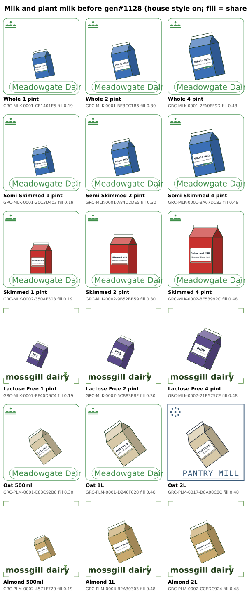
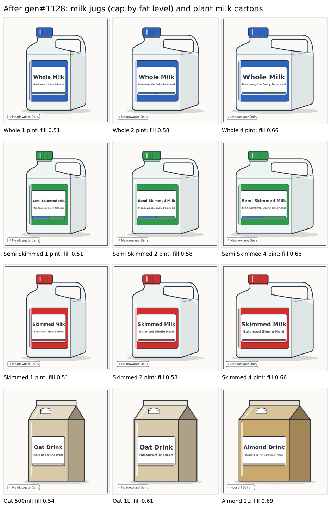
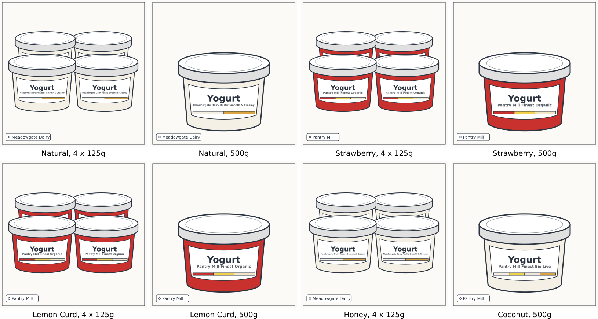
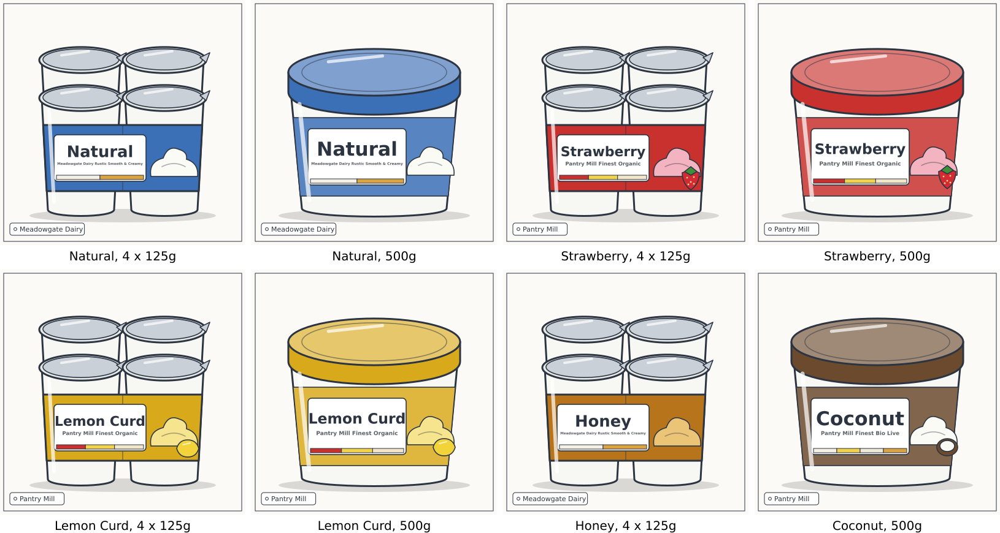

# Milk and yoghurt drawn as the jug, carton, pots or tub they are sold in (gen#1128)

Before gen#1128 every milk (`GRC-MLK`, 89 products) and plant milk (`GRC-PLM`, 112 products)
SKU drew the kit's generic `carton`, painted in its line's first flavor, and `pack_scale` shrank
the smaller sizes: a 1 pint covered a fifth of its product area, and a Semi Skimmed SKU of a line
whose first flavor is Whole drew blue.

`kit_dairy.py` now draws:

- **`milk_jug`** (milk): a translucent plastic jug of white milk, seen a little from the side,
  with a handle at the back and a cap and label in the SKU's fat level's color (`FAT_CAPS`:
  whole blue, semi skimmed green, skimmed red, as UK shelves code it, and lactose free
  purple). The 1, 2 and 4 pint jugs are drawn in their own proportions (`JUGS`), the larger
  jug wider and deeper.
- **`milk_carton`** (plant milk): a gable-top carton with a screw cap on its roof, the 500ml,
  1L and 2L in their own proportions (`CARTONS`).

Both read the SKU's own `flavor` and `pack_size` (per-SKU drawing params, as a pizza's are), so
each fat level and size is its own picture. Each carries a gloss (`class="gloss"`) and stands on
a ground shadow (`class="ground"`). Neither takes a `pack_scale` factor
(`pack_scale.SELF_SIZED`): the drawing shows its own size.

**Fill is measured as gen#1111 measures it**: the share of the plain sheet's 344 x 334 product
area (`house_styles.TURN_AREA`) that the pack (`<g class="dairy">`) paints, in
`image_release.render`'s own SVG; the ground shadow does not count.

| pack | before | after |
|---|---|---|
| Milk 1 pint | 0.19 | 0.51 |
| Milk 2 pint | 0.30 | 0.58 |
| Milk 4 pint | 0.48 | 0.66 |
| Plant Milk 500ml | 0.19 to 0.30 | 0.54 |
| Plant Milk 1L | 0.30 to 0.48 | 0.61 |
| Plant Milk 2L | 0.48 | 0.69 |

`tests/test_dairy_fill_1128.py` pins, over every milk and plant milk SKU of the 10K grocery
build: the fill between 0.50 and 0.80, no `pack_scale` factor, a jug cap in its fat level's
color (each SKU of a mixed line its own), a wider jug or carton for a larger size of one
flavor, the gloss and ground shadow, and white milk behind translucent plastic.

No milk line in the catalogue is sold in a glass bottle, so none is drawn.

## Yoghurt

Before, every yoghurt (`GRC-YOG`, 44 products) drew the kit's generic `tub` in its line's first
flavor: a Lemon Curd SKU of a Strawberry-first line drew a red tub, and a 4 x 125g was laid out
by `pack_copies` as 4 copies of that tub. `kit_dairy.py` now draws **`yogurt`** from the SKU's
own `flavor` and `pack_size`:

- **4 x 125g**: four pots, two behind two, each under a foil lid with its pull tab, the front two
  joined by a cardboard sleeve in the flavor's color. The drawing shows its own 4 pots, so
  `pack_copies` lays out one copy (`pack_copies.SELF_DRAWN_SHAPES`).
- **500g**: one large round tub under a lid in the flavor's color, a label band round it.

The label carries the flavor's name and a dollop of yoghurt in its own color (`YOGHURTS`): a
plain line (Natural, Coconut, Vanilla) is white, Strawberry pink, Lemon Curd pale yellow, Honey
amber. Strawberry, Lemon Curd and Coconut show their fruit beside the dollop. Neither pack takes
a `pack_scale` factor (`pack_scale.SELF_SIZED`).

| pack | before | after |
|---|---|---|
| Yogurt 4 x 125g | 0.58 (4 copies of the tub) | 0.59 |
| Yogurt 500g | 0.40 | 0.60 |

`tests/test_dairy_fill_1128.py` pins, over every yoghurt SKU of the 10K grocery build: the fill
between 0.50 and 0.80, one picture with no `pack_scale` factor, 4 foil-lidded pots in a sleeve
for a 4 x 125g, one lidded tub for a 500g, a white yoghurt for a plain flavor and a colored one
with its fruit for a fruit flavor, a picture of its own for each flavor and size of a line, and
the gloss and ground shadow.

The two planted `yoghurt` decoys (`Fruit Yogurt, 4 Pack`, `Strawberries and Cream Yogurt, 4 Pack`)
are not of the `Yogurt` family and keep their own `tub`.
