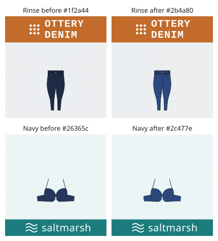

# Denim washes and navy read as blue (gen#875)

At thumbnail size a blue darker than about 0.05 relative luminance looks black on screen. Rinse
`#1f2a44` (0.024) was as dark as the Black swatch `#2a2a2e` (0.023), and Navy `#26365c` (0.038)
was barely lighter, so `blue jeans` and `navy` results looked black. That contradicted the Color
facet.

**One constant each.** The dark blues are in `domains/retail/dark_blues.py`, and every swatch
table imports them, so a later tweak is one line:

| Constant | Hex | Was |
|---|---|---|
| `RINSE` | `#2b4a80` | `#1f2a44` |
| `DARK_INDIGO` | `#32548c` | `#25345a` |
| `INDIGO` | `#3d5f97` | `#34466e` |
| `MID_WASH` | `#5578a8` | `#4a6a94` |
| `NAVY` | `#2c477e` | `#26365c`. Furniture's `#2c3e5c`, electronics' `#25365e`, Navy Patent `#1f2a4a` and Navy Blue `#1f3a68` also became `NAVY`. |
| `NAVY_LIGHT` | `#34508a` | `#2c3a5e`: the swimwear, underwear, babywear, trouser and suede shoe navy |

`variants.WASHES` keeps its order from dark to light, and Navy stays darker than the main color
Blue `#2f6db5`. Brand marks (`*_brand_styles.py`, `house_styles.py`) are not product colors and
keep their own hexes. The `Denim` and `Blue` swatches at `#4a6a94` are not a named wash and stay
as they are.

**Only pixels move.** No document carries a hex: the standard and flat documents of the authored
styles and of a 20K scaled build are byte-identical before and after. Each SKU's image file
keeps its name, and only its drawing changes. The next `v*` tag's image release
([docs/releasing.md](../releasing.md)) publishes the new drawings.

**Guard:** `tests/test_dark_blues_875.py` checks the following:

- the four washes' hexes;
- the wash order;
- every dark blue is at least 0.05 luminance and blue-dominant;
- no file under `src/` types a retired hex or copies a constant's hex;
- every solid Navy swatch draws `NAVY` or `NAVY_LIGHT`.
