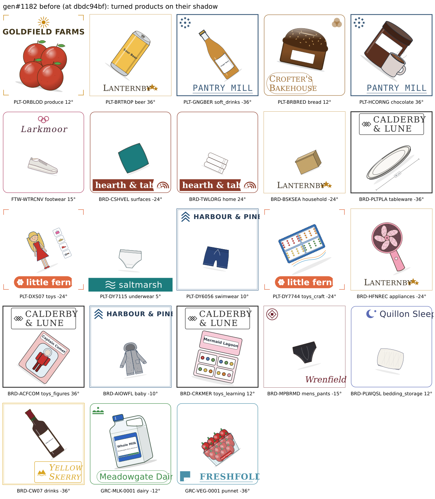
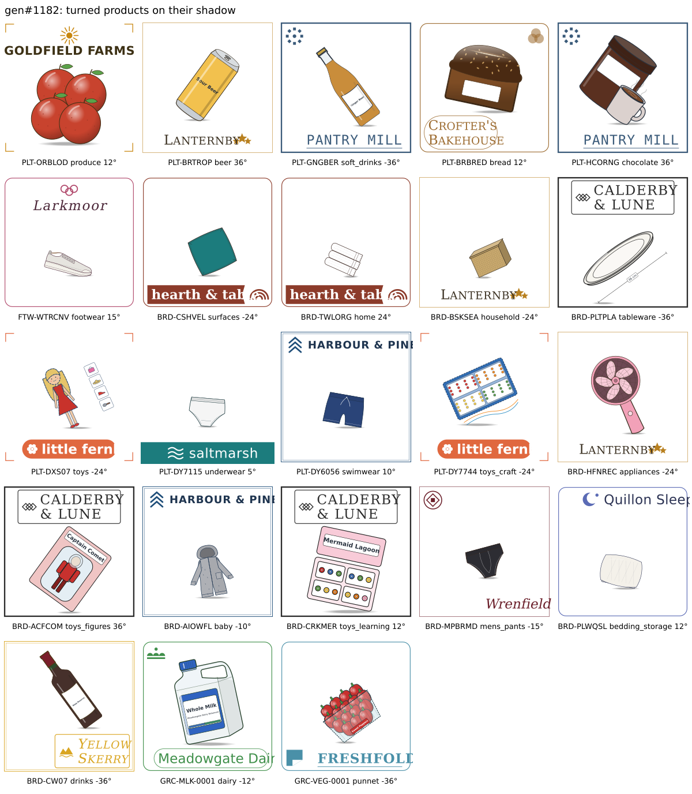

# A turned product's shadow lies flat: the redraw sweep (gen#1182)

The maintainer saw a tilted pile of Blood Oranges whose shadow was turned with it, so the pile
looked as if it sat on a slope. A kit drew its shadow inside its figure, and `house_styles.turn()`
rotated the figure and its shadow together. Slice 1 (#1231) drew the labelled `class="ground"`
shadows by one shared step, `retail/ground_shadow.py`, outside the turn: a soft horizontal ellipse
under the turned drawing's lowest point, as wide as its footprint, falling away from one light
(`ground_shadow.LIGHT`). Slice 2 (#1261) labelled every other kit's shadow and drew the level
pictures' shadows by the same step. See [images.md](../images.md) for the rule.

## The sweep

`scripts/shadow_sweep_1182.py --list` draws every template the catalogue turns
(`scale.templates()` with `orientation.drawn_angle` not 0, its first SKU) as it is served
(`image_release.render`), and counts by kit the products that stand on a shadow, and how many of
those shadows lie inside a rotation (or are more than one). It took 49 s at main `685921c1`.

The same 2,059 of the 2,298 turned products have a shadow at both commits. At `dbdc94bf`, the
commit before slice 1, every one of them was turned with its product; at `685921c1`, none is.

| kit | turned | with a shadow | not flat, before | not flat, after | shapes (with a shadow) |
|---|--:|--:|--:|--:|---|
| footwear | 435 | 420 | 420 | 0 | shoe 420 |
| drinks | 216 | 216 | 216 | 0 | wine_bottle 216 |
| dairy | 171 | 171 | 171 | 0 | milk_carton 100, milk_jug 71 |
| swimwear | 168 | 168 | 168 | 0 | bikini_bottoms 16, bikini_top 21, changing_robe 18, cover_up 17, kids_swimsuit 19, swim_bottoms 18, swim_shorts 19, swimsuit 23, tankini 17 |
| produce | 167 | 167 | 167 | 0 | produce_pile 167 |
| toys | 140 | 140 | 140 | 0 | board_game 26, building_set 73, doll 13, jigsaw 15, role_play 6, wooden_toy 7 |
| underwear | 128 | 128 | 128 | 0 | boxers 46, dressing_gown 21, knickers 25, shapewear 19, slip 16, vest 1 |
| chocolate | 89 | 89 | 89 | 0 | chocolate_box 75, hot_chocolate 14 |
| baby | 84 | 84 | 84 | 0 | all_in_one 33, baby_blanket 8, nappy_caddy 6, puddlesuit 17, sleepsuit 4, snowsuit 16 |
| punnet | 81 | 81 | 81 | 0 | punnet 81 |
| surfaces | 284 | 74 | 74 | 0 | cushion 74 |
| bread | 57 | 57 | 57 | 0 | loaf 57 |
| toys_figures | 54 | 54 | 54 | 0 | action_figure 22, brick_box 16, doll_box 16 |
| household | 46 | 46 | 46 | 0 | casserole 5, frying_pan 5, laundry_basket 4, mop 3, saucepan 4, storage_box 25 |
| toys_learning | 37 | 37 | 37 | 0 | craft_tub 17, learning_toy 20 |
| tableware | 31 | 31 | 31 | 0 | bowl 3, chopping_board 5, colander 4, drinking_glass 2, grill_press 1, kitchen_knife 5, kitchen_utensil 8, plate 3 |
| beer | 28 | 28 | 28 | 0 | beer 28 |
| mens_pants | 22 | 22 | 22 | 0 | mens_pants 22 |
| home | 31 | 17 | 17 | 0 | bath_towel 17 |
| appliances | 10 | 10 | 10 | 0 | handheld_fan 4, kettle 6 |
| bedding_storage | 10 | 10 | 10 | 0 | bed_pillow 10 |
| toys_craft | 5 | 5 | 5 | 0 | craft_kit 5 |
| soft_drinks | 4 | 4 | 4 | 0 | soft_drink 4 |
| **all** | 2,298 | 2,059 | 2,059 | 0 | |

The rows are product templates; each SKU of a template is drawn at its template's angle, so the
build redraws every SKU of these products with the flat shadow (`image_release.image_files`).

## Before and after

The Blood Oranges of the report, then the first turned product with a shadow of each other kit,
the same product ids at both commits, each as served:

    uv run python scripts/shadow_sweep_1182.py --sheet after.svg
    # in a tree of dbdc94bf, with the script copied in:
    uv run python scripts/shadow_sweep_1182.py --sheet before.svg --ids <the ids the first run printed>
    rsvg-convert -w 1200 before.svg -o flat-shadow-1182-before.png

`tests/test_shadow_sweep_1182.py` reads the served SVGs of the Blood Oranges and a shoe recorded
at both commits (`tests/fixtures/flat_shadow_1182/`): the sweep counts the old shadow as turned
and the new one as flat.
