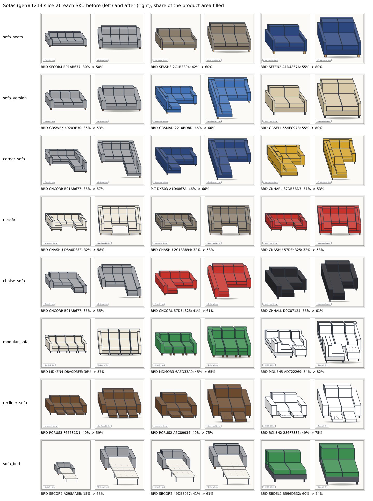
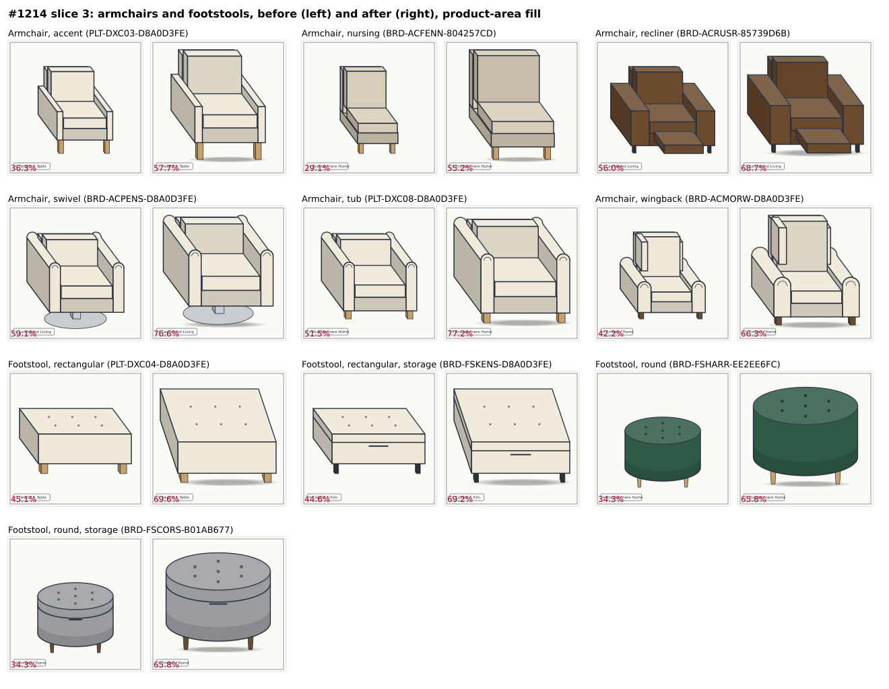

# Furniture that fills its picture (gen#1214)

Before gen#1214 the seven types of `kit_furniture` were flat front views, small on the sheet:
87% of their SKUs painted under half of the product area, the smallest size of a ladder
bookcase 4%. Slice 1 redraws the seven types, slice 2 the sofas, slice 3 the armchair and the
footstool (below); the sideboard follows.

**Each piece is drawn as it is sold**, from in front and a little above: a table shows its top
and its near edge (`kit_furniture._flat_slab`, `_ellipse_slab`), a cabinet its front, side and top
(`_cabinet`), and each surface carries a light tone and a shade over the record's own fill
(`_lit`, `_dim`, `_front`), so the color still drives the drawing. A piece stands on a
`class="ground"` shadow, which is not counted as fill; a mirror that hangs or leans has none.

- **Dining table**: its chairs stand around it, half behind the top and half in front, one at each
  end of a long table; the square table for two has one at each end.
- **Dining chair**: one chair, a set of chairs overlapped over its "set of" tag, or a bench.
- **Coffee table**: a raised lift-top over its open box, a drawer band, a shelf, or a nesting set
  with the small table pulled out in front.
- **Side table**: a round top over a shelf, a bedside cabinet, a console or a nest of three.
- **Bookcase**: standard, glass-door, a leaning ladder, or a cube unit, with books and boxes on it.
- **Wardrobe**: its doors, panels and mirrors, 206, 244 or 280 units wide for 2, 3 or 4 doors.
- **Mirror**: a lit glass in its frame; a sunburst's rays are faceted, a bathroom one has its
  glass shelf, a floor one its folding stand, a vanity one its foot.

**A size is drawn smaller, but not under half.** A dining table's, a bookcase's and a mirror's
size ladder runs from 0.84 to 0.90 (`size_ladder.BOTTOMS`), so the smallest size keeps 87% of the
largest one's area; on the shared ladder (0.55 to 0.90) it kept 37%, which no drawing could hold
at half.

**Fill is measured against the product area**, `house_styles.TURN_AREA`, by
`picture_fill_1129.measure`:

| type | before, smallest to largest | now, smallest to largest |
|---|---|---|
| Dining Table | 9% to 44% | 50.7% to 70.5% |
| Dining Chair | 9% to 53% | 53.5% to 74.8% |
| Coffee Table | 18% to 40% | 53.4% to 65.8% |
| Side Table | 11% to 33% | 60.7% to 63.9% |
| Bookcase | 4% to 50% | 54.4% to 79.4% |
| Wardrobe | 48% to 85% | 59.9% to 79.1% |
| Mirror, round, sunburst, bathroom, vanity | 11% to 53% | 50.7% to 70.3% |
| Mirror, full-length (40 x 150, 50 x 160 cm) | 12% to 33% | 30.2% to 34.5% |
| Mirror, floor (45 x 170 cm) | 35% | 37.1% |

The last two are the test's named exceptions: a solid box of 1 to 3.2 as tall as the product area
covers 30% of it. Before, both were drawn at 1 to 2.5, wider than any size they are sold in.

`tests/test_furniture_fill_1214.py` renders every SKU of the built templates of the seven types
and holds each to 50% (or its named floor), a highlight, a shadow and more than one tone.

## Slice 2: the sofas

Before slice 2, 173 of the 199 sofa SKUs painted under half of the product area: `kit_seating`
fitted every piece into a box smaller than the product area, and a sofa, long and low, filled a
strip of it. The smallest size of a sofa bed, on the shared size ladder, painted 15%.

**A sofa is fitted to the product area and seen from higher up.** `kit_seating.View` holds how a
piece is seen: how far a unit of depth moves the drawing left and up, and the area it is fitted
into. A sofa is fitted to the product area (`AREA`, less 8 units at its foot for the shadow) and
seen from above (`SOFA`), so its seat cushions show as a surface and the drawing is less sheared
wide. A straight run of four seats or more and a U-shaped sofa are seen from higher still and more
from the front (`LONG`, from `LONG_RUN` seats), a folded-out sofa bed, its mattress a bed's length
in front of it, from lower down (`BED`). Each sofa stands on a ground shadow (`ground_shadow.ellipse`, which the
picture's step redraws flat under it, gen#1182), not counted as fill. A sofa bed's size ladder
runs from 0.84 to 0.90 (`size_ladder.BOTTOMS`), as a dining table's does.

| type | shape | before, smallest to largest | now, smallest to largest |
|---|---|---|---|
| Sofa | `sofa_seats` | 30.2% to 55.2% | 50.1% to 80.2% |
| Sofa | `sofa_version` | 36.2% to 54.9% | 53.3% to 79.9% |
| Corner Sofa | `corner_sofa` | 36.1% to 51.3% | 53.5% to 67.2% |
| Corner Sofa | `u_sofa` | 31.5% | 57.8% |
| Chaise Sofa | `chaise_sofa` | 34.8% to 55.2% | 54.5% to 69.5% |
| Modular Sofa | `modular_sofa` | 35.6% to 53.8% | 57.1% to 82.4% |
| Recliner Sofa | `recliner_sofa` | 39.8% to 48.8% | 59.4% to 74.9% |
| Sofa Bed | `sofa_bed` | 15.2% to 59.8% | 53.1% to 80.5% |

The lowest now is the four-seat rolled-arm sofa, at 50.1%. `tests/test_furniture_fill_1214.py`
holds every SKU of the eight shapes to 50%, a highlight and a shadow, and checks each sofa stands
on a ground shadow that the measure skips.

## Slice 3: the armchair and the footstool

Before slice 3, 14 of the 24 armchair SKUs and all 17 footstool SKUs painted under half of the
product area: both were still fitted into `CHAIR`'s smaller box, and a footstool, low and wide,
filled a strip of it.

**An armchair is fitted to the product area** (`CHAIR`, now `AREA` and a ground shadow), from in
front and a little above as before. Its back cushion carries a light shade over its front, so no
one solid color paints most of the figure once the drawing is larger and its outlines take a
smaller share. A nursing chair, armless, is drawn 16 units wider in the seat, as the real one is,
so its high back is not a narrow strip. A swivel chair is fitted a little higher (`SWIVEL`), so
its round foot and the shadow under it stay inside the product area.

**A footstool is seen from higher up** (`STOOL`), so its buttoned top reads as a surface, and a
round footstool's drum is scaled to 0.9 of the product area, centred, on a ground shadow.

| type | form | before, smallest to largest | now, smallest to largest |
|---|---|---|---|
| Armchair | accent, nursing, wingback, recliner, tub, swivel | 29.1% to 59.1% | 55.2% to 77.2% |
| Footstool | rectangular, round | 34.3% to 45.1% | 65.8% to 69.6% |

The lowest now is the nursing chair, at 55.2%. `tests/test_furniture_fill_1214.py` holds every
armchair and footstool SKU to 50%, a highlight and a shadow, and checks each form of each seat
stands on a ground shadow that the measure skips.

