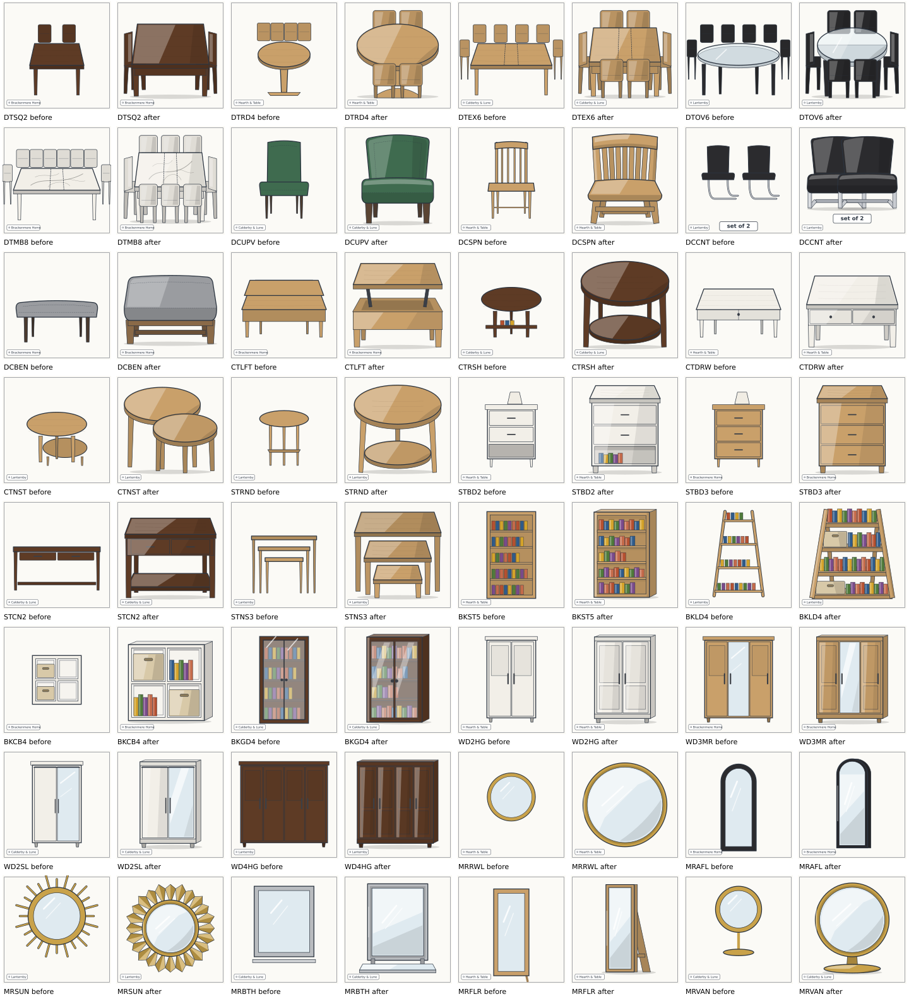

# Furniture that fills its picture (gen#1214)

Before gen#1214 the seven types of `kit_furniture` were flat front views, small on the sheet:
135 of their 155 SKUs painted under half of the product area, the smallest size of a ladder
bookcase 4%. Slice 1 redraws the seven types. The sofas follow in slice 2, the armchair, the
footstool and the sideboard in slice 3.

**Each piece is drawn as it is sold**, from in front and a little above: a table shows its top
and its near edge (`kit_furniture._flat_slab`, `_ellipse_slab`), a cabinet its front, side and top
(`_cabinet`), and each surface carries a light tone and a shade over the record's own fill
(`_lit`, `_dim`, `_front`), so the color still drives the drawing. A piece stands on a
`class="ground"` shadow, which is not counted as fill; a mirror that hangs or leans has none.

- **Dining table**: its chairs stand around it, half behind the top and half in front, one at each
  end of a long table; the square table for two has one at each end.
- **Dining chair**: one chair, a set of chairs overlapped over its "set of" tag, or a bench.
- **Coffee table**: a raised lift-top over its open box, a drawer band, a shelf, or a nesting set
  with the small table pulled out in front.
- **Side table**: a round top over a shelf, a bedside cabinet, a console or a nest of three.
- **Bookcase**: standard, glass-door, a leaning ladder, or a cube unit, with books and boxes on it.
- **Wardrobe**: its doors, panels and mirrors, 206, 244 or 280 units wide for 2, 3 or 4 doors.
- **Mirror**: a lit glass in its frame; a sunburst's rays are faceted, a bathroom one has its
  glass shelf, a floor one its folding stand, a vanity one its foot.

**A size is drawn smaller, but not under half.** A dining table's, a bookcase's and a mirror's
size ladder runs from 0.84 to 0.90 (`size_ladder.BOTTOMS`), so the smallest size keeps 87% of the
largest one's area; on the shared ladder (0.55 to 0.90) it kept 37%, which no drawing could hold
at half.

**Fill is measured against the product area**, `house_styles.TURN_AREA`, by
`picture_fill_1129.measure`:

| type | before, smallest to largest | now, smallest to largest |
|---|---|---|
| Dining Table | 9% to 44% | 50.7% to 70.5% |
| Dining Chair | 9% to 53% | 53.5% to 74.8% |
| Coffee Table | 18% to 40% | 53.4% to 65.8% |
| Side Table | 11% to 33% | 60.7% to 63.9% |
| Bookcase | 4% to 50% | 54.4% to 79.4% |
| Wardrobe | 48% to 85% | 59.9% to 79.1% |
| Mirror, round, sunburst, bathroom, vanity | 11% to 53% | 50.7% to 70.3% |
| Mirror, full-length (40 x 150, 50 x 160 cm) | 12% to 33% | 30.2% to 34.5% |
| Mirror, floor (45 x 170 cm) | 35% | 37.1% |

The last two are the test's named exceptions: a solid box of 1 to 3.2 as tall as the product area
covers 30% of it. Before, both were drawn at 1 to 2.5, wider than any size they are sold in.

`tests/test_furniture_fill_1214.py` renders every SKU of the built templates of the seven types
and holds each to 50% (or its named floor), a highlight, a shadow and more than one tone.

