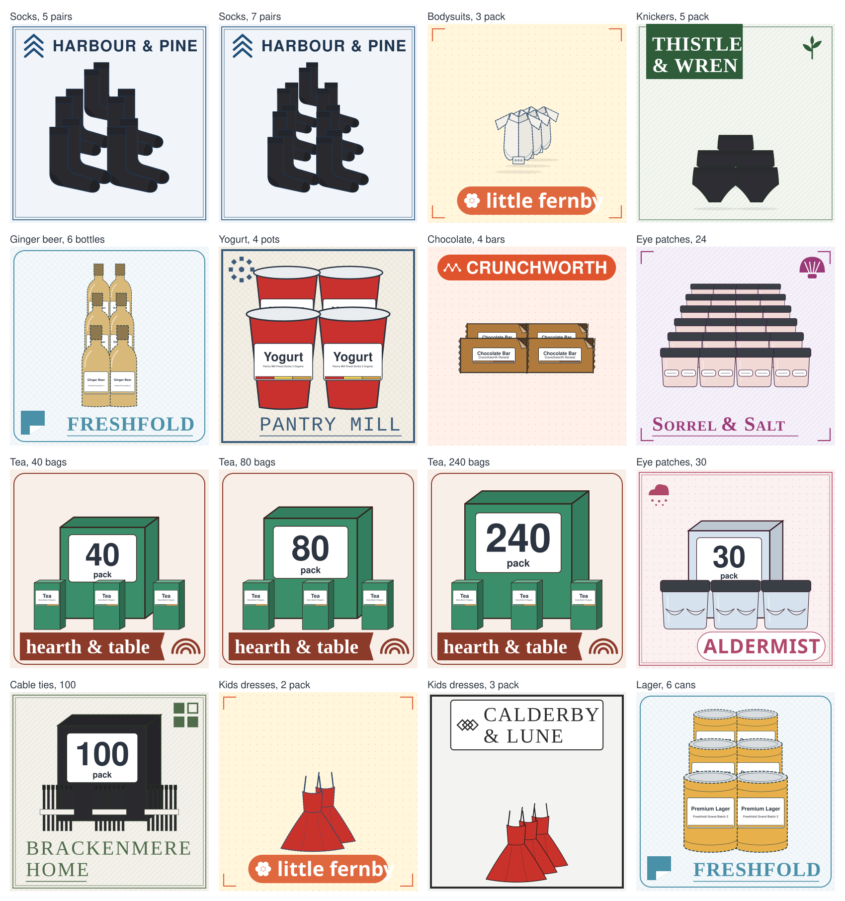

# A pack of N shows N items (gen#728)

A SKU that is a pack draws its items, so a six-pack does not look like one can. One layout does
this for every family (`pack_copies.py`): a new family needs no pack drawing of its own.

**The count** is the SKU's `units_per_pack`, its `pack_size` (`4 x 125g`, `3 pack`, `40 bags`), the
product's one pack attribute, a sock row's `pairs`, or the title (`4 Pack`, `5pk`, `Pack of 10`,
`Set of 2`, `Twin Pack`, `..., Pair`). It goes through `export.drawing_spec`, so each count is its
own drawing.

**Up to 3** the copies stand in a file: each is 5% smaller than the one in front of it, and offset
up and to the right. **From 4 to 24** they stand in rows: the front row is full size and each row
behind is 10% smaller and higher, so a six-pack is two in front with two more rows behind. A wide
item takes fewer columns, and a tall one no more than a square would. A stack past the product's
area on the sheet is scaled down as a whole and centered.

**Above 24** the pack is its outer box, in the product's own paint, with the count large on its
front and three loose items before it (`pack_copies.outer_box`). The box grows with the logarithm
of the count, so 40, 80 and 240 tea bags tell apart side by side. A larger pack needs no new drawing.

The product's drawing goes once into a `<defs>` and each copy is a `<use>` of it. Ids stay unique,
the file stays small, and every copy is the same product in the same swatch. `sheet_extent.reach`
measures through a `<use>`, so the sheet guard (`tests/test_retail_sheet_242.py`) holds a stack to
the same bounds as a single drawing.

**A drawing that already shows its count stays as it is** (`pack_copies.self_drawn`): a pile of
fruit, a nest of tables, four rubber pads, and any drawing with its own `count`, `pieces` or `units`
of that number, such as a set of steak knives. A pile draws its own SKU's count, not the first pack
of its line (`pack_copies.pile_count`). `tub`, `socks` and `school_shirt` drew their own
packs and moved onto the layout. A shape that draws several items by default is told to draw one
for a pack (`pack_copies.ONE_ITEM`: hangers, a pile of towels, packing cubes), so a copy is one item.

A pack takes no pack factor ([the pack scale page](pack-scale-543.md)): its copies show its size. A
single of the same line keeps its factor.

`tests/test_retail_pack_copies_728.py` holds the whole catalogue to this. The strip is drawn by
`pack_copies_strip.py`, and the test compares it with `docs/images/pack-copies.svg`. The catalogue
sells no six cans, so that cell gives a real product that pack's size.

A changed drawing reaches the catalogue through the next image release
([docs/releasing.md](../releasing.md)).
