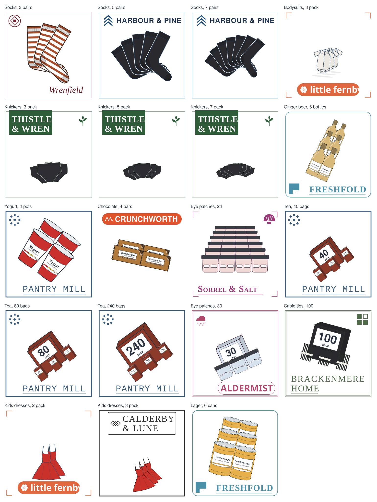

# A pack of N shows N items (gen#728, gen#734)

A SKU that is a pack draws its items, so a six-pack does not look like one can. One layout does
this for every family (`pack_copies.py`): a new family needs no pack drawing of its own.

**The count** is the SKU's `units_per_pack`, its `pack_size` (`4 x 125g`, `3 pack`, `40 bags`), the
product's one pack attribute, a sock row's `pairs`, or the title (`4 Pack`, `5pk`, `Pack of 10`,
`Set of 2`, `Twin Pack`, `..., Pair`). It goes through `export.drawing_spec`, so each count is its
own drawing.

**Up to 3** the copies stand in a file: each is 5% smaller than the one in front of it, and offset
up and to the right. **From 4 to 24** they stand in rows: the front row is full size and each row
behind is 10% smaller and higher, so a six-pack is two in front with two more rows behind. A wide
item takes fewer columns, and a tall one no more than a square would. A stack past the product's
area on the sheet is scaled down as a whole and centered.

**Socks and knickers fan** (gen#734). In rows, socks read as a heap and knickers as a stepped pyramid,
with most of each item hidden. A shop's listing lays them flat in one overlapped sweep, so `pack_copies.FANS`
turns each item about a point below the pack. Socks go left to right, one sock for each pair, each
lying on the one before it. Knickers keep to a shallow arc with the middle one last, so it lies
whole on top with the rest showing to either side. Each item lies on a light edge of its own, the
silhouette of its painted paths, so black ones on black can still be counted. A family joins by a
line in `FANS`, and `tests/test_retail_pack_fan_734.py` measures what shows of each item.

**Above 24** the pack is its outer box, in the product's own paint, with the count large on its
front and three loose items before it (`pack_copies.outer_box`). The box grows with the logarithm
of the count, so 40, 80 and 240 tea bags tell apart side by side. A larger pack needs no new drawing.

The product's drawing goes once into a `<defs>` and each copy is a `<use>` of it. Ids stay unique,
the file stays small, and every copy is the same product in the same swatch. `sheet_extent.reach`
measures through a `<use>`, so the sheet guard (`tests/test_retail_sheet_242.py`) holds a stack to
the same bounds as a single drawing.

**A drawing that already shows its count stays as it is** (`pack_copies.self_drawn`): a pile of
fruit, a nest of tables, four rubber pads, and any drawing with its own `count`, `pieces` or `units`
of that number, such as a set of steak knives. A pile draws its own SKU's count, not the first pack
of its line (`pack_copies.pile_count`). `tub`, `socks` and `school_shirt` drew their own
packs and moved onto the layout. A shape that draws several items by default is told to draw one
for a pack (`pack_copies.ONE_ITEM`: hangers, a pile of towels, packing cubes), so a copy is one item.

A pack takes no pack factor ([the pack scale page](pack-scale-543.md)): its copies show its size. A
single of the same line keeps its factor.

`tests/test_retail_pack_copies_728.py` holds the whole catalogue to this. The strip is drawn by
`pack_copies_strip.py`, and the test compares it with `docs/images/pack-copies.svg`. The catalogue
sells no six cans, so that cell gives a real product that pack's size.

## Sets and piece sets (the 2026-11-04 scan)

A set of 4 espresso cups was drawn with 8 cups, and a scan found 61 product types whose title
states a count. A title's count (`Set of 4`, `Box of 12`, `Set of Three`, `6 Pack`, `16 Piece`,
`..., Pair`) is `pack_copies.title_count`, and every such count is drawn one of four ways:

- **copies**: the layout above. A piece set whose piece is one item (`pack_copies.PIECE_COPIES`:
  a screwdriver set, a set of chopping boards, a dinosaur figure set) lays out its "N Piece" too.
- **outer box**: above 24, as above.
- **own drawing**: the shape draws its count itself (`pack_copies.shown`): a suit's 2 or 3
  pieces, a nest of 3 tables, a craft kit's paints and brushes (its `counts`), a drill bit case
  with every bit its contents name and the case (up to 23 bits), a knife block's 5 knives and the
  block.
- **printed**: a piece set whose drawing shows its parts rather than N items (a dinner set's
  plate, bowl and mug, a cutlery set's fork, knife and spoon, a tool kit's case and tools), or a
  count above 24 that the shape draws itself (a 1000 piece puzzle), carries the count on a white
  tag at the top right of the product (`pack_copies.count_tag`).

`tests/test_retail_set_counts_728.py` renders one SKU per (type, title N, SKU count) of the
ceiling build and fails on any whose drawn count is not the title's. The table is that test's
reading, made by `uv run python -m synthetic_ecommerce_data.domains.retail.pack_counts`:

Title N against the count drawn, per type (120 rows)

| Type | Title N | Drawn | How | Example |
|---|---:|---:|---|---|
| Anti-Vibration Mat | 4 | 4 | own drawing | Rubber Floor Pads for Laundry Machines, Set of 4 |
| Arts and Crafts Kit | 6 | 6 | own drawing | Learn to Knit Kit, 6 Piece |
| Arts and Crafts Kit | 9 | 9 | own drawing | Little Fernby Hazelwren Owls First Painting Set, 9 Piece |
| Arts and Crafts Kit | 10 | 10 | own drawing | Slime Making Kit, 10 Piece |
| Arts and Crafts Kit | 13 | 13 | own drawing | Bead Jewelry Making Kit, 13 Piece |
| Arts and Crafts Kit | 15 | 15 | own drawing | Watercolor Painting Set, 15 Piece |
| Arts and Crafts Kit | 26 | 26 | printed | Pipwick Toys Moonmoth Rangers Coloring Set, 26 Piece |
| Bath Toy | 3 | 3 | copies | Foam Cat Bath Floaters, Set of 3 |
| Battery | 4 | 4 | copies | AA Alkaline Batteries, 4 Pack |
| Battery | 8 | 8 | copies | AAA Alkaline Batteries, 8 Pack |
| Bit Set | 32 | 32 | outer box | Screwdriver Bit Set, 32 Piece |
| Bit Set | 100 | 100 | outer box | Screwdriver Bit Set, 100 Piece |
| Boot Socks | 3 | 3 | copies | Grey Boot Socks 3 Pack |
| Boys Suit | 2 | 2 | own drawing | Boys 2 Piece Slim Fit Polyester Suit |
| Boys Suit | 3 | 3 | own drawing | Boys 3 Piece Regular Fit Wool Suit |
| Bulbs | 10 | 10 | copies | Purple Parrot Tulip Bulbs, Pack of 10 |
| Bulbs | 20 | 20 | copies | Yellow Triumph Tulip Bulbs, Pack of 20 |
| Bulbs | 25 | 25 | outer box | Apricot Lily-Flowered Tulip Bulbs, Pack of 25 |
| Bulbs | 50 | 50 | outer box | Red Single Late Tulip Bulbs, Pack of 50 |
| Chopping Board | 3 | 3 | copies | Plastic Chopping Board Set, 3 Piece |
| Clothes Hangers | 4 | 4 | copies | White Skirt Hangers, 4 Pack |
| Clothes Hangers | 6 | 6 | copies | Black Coat Hangers, 6 Pack |
| Clothes Hangers | 10 | 10 | copies | Velvet Hangers, Pack of 10 |
| Coffee | 30 | 30 | outer box | Brazilian Coffee Pods, Pack of 30 |
| Coffee Table | 2 | 2 | own drawing | Round Oak Nesting Coffee Tables, Set of 2 |
| Cushion | 2 | 2 | copies | Red Sofa Cushion Cover, Set of 2 |
| Cutlery | 4 | 4 | own drawing | Steak Knife Set of 4 with Wooden Handles |
| Cutlery | 6 | 6 | own drawing | Steak Knives Set of 6 |
| Cutlery | 8 | 8 | own drawing | Steak Knife and Fork Set of 8 |
| Cutlery | 12 | 12 | own drawing | Steak Knife Set of 12 with Black Handles |
| Cutlery Set | 16 | 16 | printed | Stainless Steel Cutlery Set, 16 Piece |
| Cutlery Set | 24 | 24 | printed | Bamboo Handle Cutlery Set, 24 Piece |
| Dining Chair | 2 | 2 | own drawing | Cantilever Faux Leather Dining Chairs, Set of 2 |
| Dinner Set | 12 | 12 | printed | White Porcelain Dinner Set, 12 Piece |
| Dinner Set | 16 | 16 | printed | Speckled Stoneware Dinner Set, 16 Piece |
| Dish Soap | 60 | 60 | outer box | Dishwasher Tablets, 60 Pack |
| Doll | 4 | 4 | own drawing | Doll's House Family Figures, 4 Piece |
| Doughnut | 4 | 4 | copies | Sugar Ring Doughnuts, Pack of 4 |
| Dress | 2 | 2 | copies | Womens Cotton Jersey T-Shirt Dresses, Pack of 2 |
| Dress | 3 | 3 | copies | Womens Cotton Jersey T-Shirt Dresses, Pack of 3 |
| Drill Bit Set | 6 | 6 | own drawing | SDS-Plus Masonry Drill Bit Set, 6 Piece |
| Drill Bit Set | 11 | 11 | own drawing | Hex Shank Drill Bit Set, 11 Piece |
| Drill Bit Set | 13 | 13 | own drawing | Masonry Drill Bit Set, 13 Piece |
| Drill Bit Set | 19 | 19 | own drawing | Wood Drill Bit Set, 19 Piece |
| Drill Bit Set | 42 | 42 | printed | Multi-Purpose Drill Bit Set, 42 Piece |
| Fridge Magnets | 6 | 6 | copies | Fridge Magnets, Set of 6 |
| Fridge Magnets | 8 | 8 | copies | Photo and Note Magnets, Set of 8 |
| Glass Cleaner | 40 | 40 | outer box | Eucalyptus Glass Cleaning Wipes, Pack of 40 |
| Glassware | 4 | 4 | copies | Red Wine Glasses, Set of 4 |
| Hanger | 3 | 3 | copies | Denim Shorts Hanger, Set of 3 |
| Hanger | 4 | 4 | copies | Tea Towel Hanger, 4 Pack |
| Hanger | 5 | 5 | copies | Jeans Hanger, Pack of 5 |
| Hanger | 10 | 10 | copies | Blue Shirt Hangers, Pack of 10 |
| Jigsaw Puzzle | 24 | 24 | own drawing | Puddlecombe Toys Driftwhistle Bay 24 Piece Floor Puzzle |
| Jigsaw Puzzle | 35 | 35 | printed | Pipwick Toys Rumblesaur Ridge 35 Piece Jigsaw Puzzle |
| Jigsaw Puzzle | 48 | 48 | printed | Pipwick Toys Moonmoth Rangers 48 Piece Jigsaw Puzzle |
| Jigsaw Puzzle | 100 | 100 | printed | World Map 100 Piece Jigsaw Puzzle |
| Jigsaw Puzzle | 500 | 500 | printed | Harbour Village 500 Piece Jigsaw Puzzle |
| Jigsaw Puzzle | 1000 | 1000 | printed | Alpine Lake 1000 Piece Jigsaw Puzzle |
| Kitchen Knife | 6 | 6 | own drawing | Knife Block Set, 6 Piece |
| Kitchen Roll | 4 | 4 | copies | Absorbent Paper Towels, Pack of 4 |
| Kitchen Roll | 6 | 6 | copies | Kitchen Roll, Pack of 6 |
| Kitchen Utensil | 5 | 5 | own drawing | Silicone Utensil Set with Holder, 5 Piece |
| Lemons | 4 | 4 | own drawing | Unwaxed Lemons, Pack of 4 |
| Luggage Set | 2 | 2 | own drawing | 2 Piece Hard Shell Luggage Set |
| Luggage Set | 3 | 3 | own drawing | 3 Piece Hard Shell Luggage Set |
| Oranges | 5 | 5 | own drawing | Valencia Oranges, Pack of 5 |
| PE Shorts | 2 | 2 | copies | Short Leg PE Shorts, 2 Pack |
| Paper Cup | 30 | 30 | outer box | Printed Paper Cups for Cold Drinks, Pack of 30 |
| Paper Cup | 40 | 40 | outer box | Compostable Paper Cups for Coffee to Go, Pack of 40 |
| Paper Cup | 50 | 50 | outer box | Double Wall Paper Cups for Hot Drinks, Pack of 50 |
| Party Cup | 20 | 20 | copies | Sturdy Reusable Plastic Party Cups, Pack of 20 |
| Party Cup | 50 | 50 | outer box | Stackable Plastic Party Cups with Rolled Rim, Pack of 50 |
| Picture Hook | 6 | 6 | copies | Double Pin Picture Hooks, 6 Pack |
| Picture Hook | 10 | 10 | copies | Brass Picture Hooks, 10 Pack |
| Pillow | 2 | 2 | copies | Microfibre Pillow Pair |
| Pillow Protector | 2 | 2 | copies | Pillow Protectors, Pair |
| Pillowcase | 2 | 2 | copies | Percale Pillowcase Pair |
| Plant | 6 | 6 | copies | Elsanta Strawberry Plants, Pack of 6 |
| Plant | 8 | 8 | copies | Symphony Strawberry Plants, Pack of 8 |
| Plant | 9 | 9 | copies | Cambridge Favourite Strawberry Plants, Pack of 9 |
| Plant | 12 | 12 | copies | Honeoye Strawberry Plants, Pack of 12 |
| Ring | 3 | 3 | own drawing | Set of Three Stacking Rings |
| Role Play Toy | 10 | 10 | own drawing | Puddlecombe Toys Driftwhistle Bay Wooden Tea Set, 10 Piece |
| Saucepan | 3 | 3 | own drawing | Stainless Steel Saucepan Set, 3 Piece |
| Saucepan | 5 | 5 | own drawing | Non-Stick Aluminum Saucepan Set, 5 Piece |
| School Polo Shirt | 2 | 2 | copies | Short Sleeve School Polo Shirt, 2 Pack |
| School Polo Shirt | 3 | 3 | copies | Short Sleeve School Polo Shirt, 3 Pack |
| School Shirt | 2 | 2 | copies | Long Sleeve School Shirt, 2 Pack |
| School Shirt | 3 | 3 | copies | Short Sleeve School Shirt, 3 Pack |
| School Socks | 3 | 3 | copies | Knee High School Socks, 3 Pack |
| School Socks | 5 | 5 | copies | Ankle School Socks, 5 Pack |
| School Socks | 7 | 7 | copies | Ankle School Socks, 7 Pack |
| School Trousers | 2 | 2 | copies | Regular Fit School Trousers, 2 Pack |
| Screwdriver Set | 6 | 6 | copies | Slotted and Phillips Screwdriver Set, 6 Piece |
| Side Table | 3 | 3 | own drawing | Oak Nest of Tables, Set of 3 |
| Socket Set | 40 | 40 | printed | Socket Set, 40 Piece |
| Socket Set | 94 | 94 | printed | Socket Set, 94 Piece |
| Socks | 3 | 3 | copies | Striped Cotton Socks 3 Pack |
| Socks | 5 | 5 | copies | Cotton Rich Ankle Socks 5pk |
| Socks | 7 | 7 | copies | Cotton Rich Socks 7 Pack |
| Tea Towels | 2 | 2 | copies | Oranges Print Tea Towels, Set of 2 |
| Toilet Cleaner | 2 | 2 | own drawing | Lemon Rim Block, Twin Pack |
| Toilet Cleaner | 8 | 8 | copies | Ocean Breeze Toilet Cleaning Tablets, Pack of 8 |
| Tool Kit | 6 | 6 | printed | Tool Kit, 6 Piece |
| Tool Kit | 24 | 24 | printed | Tool Kit, 24 Piece |
| Tool Kit | 40 | 40 | printed | Tool Kit, 40 Piece |
| Tool Kit | 61 | 61 | printed | Tool Kit, 61 Piece |
| Towel | 4 | 4 | copies | Cream Face Cloths 4 Pack |
| Toy Figure | 6 | 6 | copies | Plastic Dinosaur Figure Set, 6 Piece |
| Toy Vehicle | 3 | 3 | copies | Die-Cast Cars, Pack of 3 |
| Toy Vehicle | 5 | 5 | copies | Die-Cast Cars, Pack of 5 |
| Tracksuit | 3 | 3 | own drawing | 3 Piece Half-Zip Tracksuit Set with Tee |
| Travel Organizer | 3 | 3 | copies | Suitcase Packing Cubes, Set of 3 |
| Travel Organizer | 4 | 4 | copies | Packing Cubes, Set of 4 |
| Wash Bags | 3 | 3 | copies | Zipped Wash Bags, Pack of 3 |
| Wooden Toy | 6 | 6 | own drawing | Wooden Stacking Rings, 6 Piece |
| Wooden Toy | 7 | 7 | own drawing | Wooden Shape Sorter Cube, 7 Piece |
| Wooden Toy | 9 | 9 | own drawing | Wooden Train Set, 9 Piece |
| Yogurt | 4 | 4 | copies | Fruit Yogurt, 4 Pack |

The cup set of the report is no longer a "Set of 4": #851 made each brand's set one product of 2,
4 and 8 packs with no count in its title, and each SKU draws its own count.

A changed drawing reaches the catalogue through the next image release
([docs/releasing.md](../releasing.md)).
