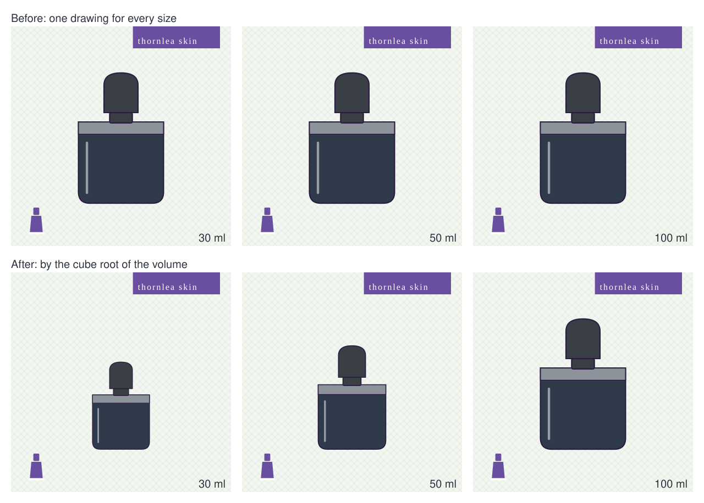

# Pack scale (gen#543)

Images are keyed per style and colorway, and per pack scale: a SKU's pack is drawn at
about the cube root of its net volume (or weight, or count) against the largest size of
its line, floored at 0.6 (a loaf at 0.9, so it still fills its picture: [gen#1126](bread-1126.md)), on the same 400 x 400 sheet and baseline, so a 30 ml jar is
visibly smaller than a 100 ml one (`pack_scale.py`). The largest size, and a line of one
size, draw as they always did. Every size drawn at one scale shares its color's image,
drawn in that color's swatch (base, pattern and accent).

`image_release.py --skus 20000` is 1,346 images for 20,074 SKUs.

**Each family that sizes its own pack is its own module (#1151).** `pack_scale.SELF_SIZED` (the shapes that take no factor) and `pack_scale.SHAPE_FLOORS` (a shape's own floor) are built by walking `pack_scale_families/`: one module per family (`produce`, `drinks`, `soft_drinks`, `dairy`, `chocolate`, `bread`), each exposing `SELF_SIZED` and/or `FLOORS` and saying why in its docstring. A new family adds a module there and `pack_scale.py` gains no line; a module that defines neither, or a shape two modules claim, is refused.

**A wine bottle draws its own size (gen#1127).** `wine_bottle` takes no factor (`pack_scale.SELF_SIZED`, beside `produce_pile`): it draws each size at its real proportions against its line's largest, never below 0.8 of its height. See [the wine bottle page](wine-bottles-1127.md).

**A soft drink draws its own size too (gen#1127).** `soft_drink` takes no factor: its bottle steps down as a wine bottle does, and its can and multipack of cans fill half the product area. See [the soft drinks page](soft-drinks-1127.md).

**A beer draws its own size too (gen#1127).** `beer` takes no factor: its bottle steps down as a wine bottle does, a can stands at the full height, and its 4-pack fills the product area's width. See [the beer page](beer-1127.md).
