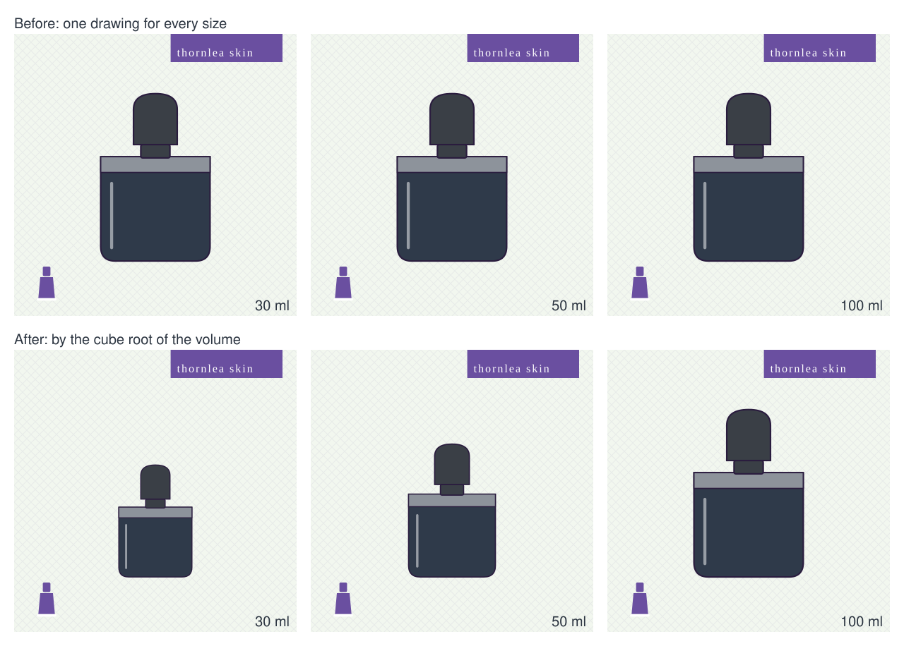

# Pack scale (gen#543)

Images are keyed per style and colorway, and per pack scale: a SKU's pack is drawn at
about the cube root of its net volume (or weight, or count) against the largest size of
its line, floored at 0.6, on the same 400 x 400 sheet and baseline, so a 30 ml jar is
visibly smaller than a 100 ml one (`pack_scale.py`). The largest size, and a line of one
size, draw as they always did. Every size drawn at one scale shares its color's image,
drawn in that color's swatch (base, pattern and accent).

`image_release.py --skus 20000` is 1,346 images for 20,074 SKUs.
