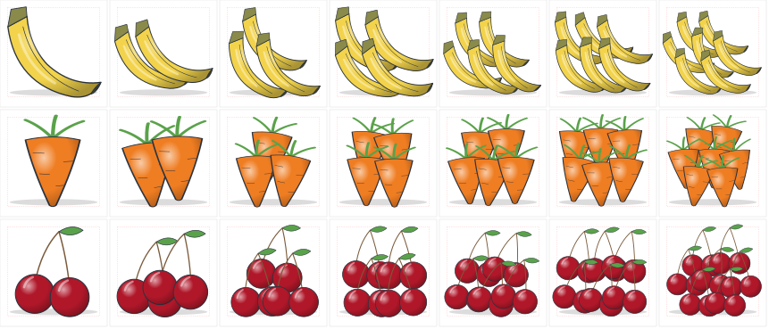
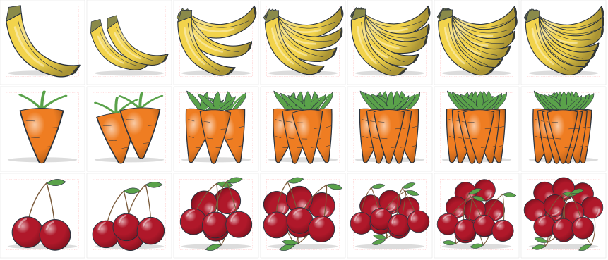
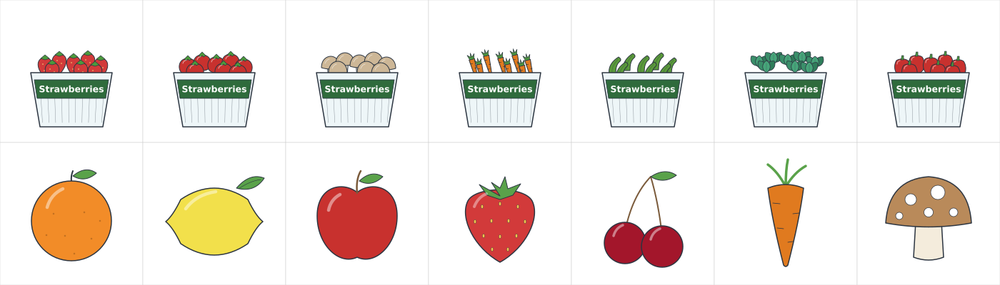
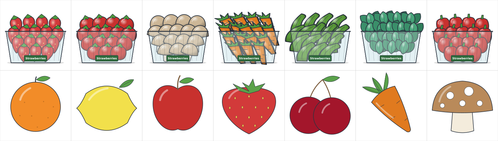
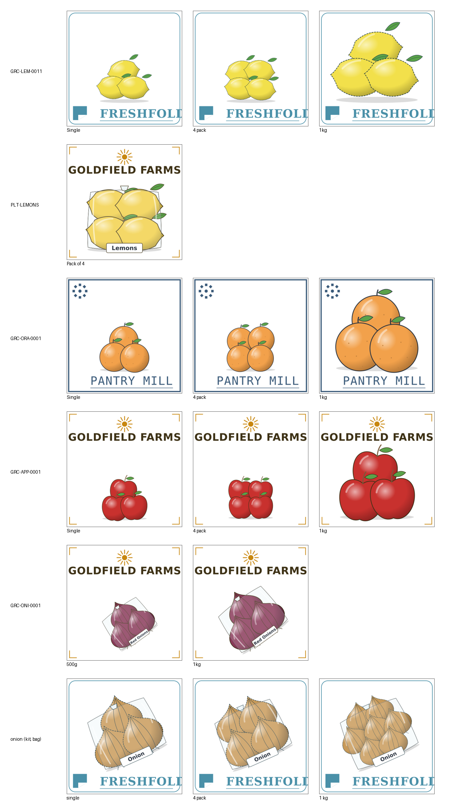

# Produce that fills its picture (gen#1111)

A pack of loose fruit or vegetables (`kit_produce.produce_pile`: loose, in a net or in a
clear bag) is drawn big, round and fresh. Each layout in `PILES` (1 to 7 fruits) gives its
fruits one size, and every fruit is scaled to the same painted area at that size whatever its
own shape's size, so a lemon and a grape fill the same space. Each fruit carries a gloss (a
radial highlight up-left and a shade down-right over its body), and the pile stands on a
`class="ground"` shadow. The bag and the net are enlarged round the bigger pile.

**Fill is measured against the product area**, the plain sheet's 344 x 334 box
(`house_styles.TURN_AREA`), and counts only the fruits (`<g class="fruit">`): a bag's film, a
net, a tag and the shadow do not count. `sheet_cover.cover` rasterizes the SVG on a grid and
returns the painted share of a box. A share of the whole 400 x 400 image cannot reach one half
for a round fruit once a house style frames it, so the contact sheets report both.

| shapes | floor | measured (counts 3-7, and 1-2 for a round body) |
|---|---|---|
| orange, lemon, apple, strawberry, tomato, onion, potato | 0.50 | 0.52 to 0.79 |
| banana, carrot, cherries, 3 to 7 (a hand, a bunch, a heap) | 0.50 | 0.51 to 0.71 |
| banana, carrot, cherries, 1 or 2 alone | 0.25 | 0.28 to 0.43 |

`tests/test_produce_fill_1111.py` pins the floors over every `FRUIT` x pack form x count, the
gloss on each fruit and the ground shadow.

**A banana, carrot or cherry pile has its own arrangement (slice 3, first cut).** `PILES`' grid
leaves a long or forked fruit's box mostly empty (0.38 to 0.57 before), so three or more of
them are laid out by `kit_produce.ARRANGE` and the whole arrangement is scaled to fill `ROOM`:

- a **hand** of bananas: every banana turns about its stalk, fanned over 55 degrees, so the
  hand hangs from one crown;
- a **bunch** of carrots: every carrot turns about its top, the tops side by side and the roots
  fanned out, the middle carrot in front; each carrot carries filled leafy tops
  (`CARROT_TOPS`) under its frond lines, so the bunch is green at its tie;
- a **heap** of cherry pairs in rows narrowing to the top (`HEAP_ROWS`): the front row stands
  stalk up over the fruit behind it, and each pair behind lies stalk down, its stalk hidden.

Each fruit still turns a little by the product's hash (`jitter`), so two products' hands
differ. The test also checks that a hand's stalks meet (they span at most a quarter of what its
tips span) and that a bunch's tops are tied closer than its roots spread. One or two long
fruits alone (a Single banana) keep slice 1's drawing and its 0.25 floor. The punnet and the
single motifs follow in slice 4 below; distinct heaps for the small-fruit weights in their own PR.

**The punnet and the single motifs fill their picture too (slice 4).** Before it, a punnet
(`kit_punnet.punnet`, the GRC-VEG lines) drew eight small items peeking over an opaque tray
under a wide label band, and a fruit or vegetable motif drawn alone (`kit_motifs`: orange,
lemon, apple, strawberry, cherries, carrot, mushroom; a strawberry plant's or a growing kit's
picture) covered 0.12 to 0.35 of the product area.

- A **punnet** is a heap of 16 items (`HEAP`) behind a clear tray: the back row stands over
  the rim and the rest shows through the tray's film. Every item is drawn to the same painted
  area (`ITEM_AREA`) whatever its own size, no longer than `ITEM_LONGEST`, and a baby carrot
  or a bean is drawn chunkier (`STRETCH`). Each carries the produce kit's gloss, and the label
  is a small sticker on the tray's front (`class="label"`).
- Each **motif** is redrawn large, keeping its highlight; the carrot lies on the diagonal with
  filled leafy tops. A produce pile keeps drawing the small fruit its layouts are in the units
  of (`kit_motifs.PILE_FRUIT`), so no pile changes.

| drawing | floor | before | after |
|---|---|---|---|
| punnet, produce shown (not under the label), each of 7 `PRODUCE` | 0.50 | none measurable: under 0.35 with the tray | 0.51 to 0.58 |
| orange, lemon, apple, strawberry, cherries, mushroom motif | 0.50 | 0.19 to 0.35 | 0.53 to 0.55 |
| carrot motif (long, drawn alone) | 0.25 | 0.12 | 0.29 |

`tests/test_produce_fill_1111.py` pins both floors, and checks that nothing opaque but the label
is drawn over a punnet's produce. Distinct heaps for the small-fruit weights follow in their own
PR.

**Each SKU draws its own pack (slice 2).** A grocery line's drawing is made from its first
pack, and before slice 2 every other SKU kept it: a Single lemon drew a pile of 3, a 1 kg bag
drew the Single's 3 loose fruit, and a 4 pack lay loose. `kit_produce.sku_pile` now reads a pack's
form and count from its own `pack_size` (`pack_form`: a Single lies loose, a count pack is netted,
a weight is bagged) and its `units_per_pack` or `net_weight_g`; `grocery._drawing` uses it for the
first pack and `pack_copies.pile_count` for every other. `fruit_count` draws a count pack from 1
(a Single is one fruit) and clamps only a weight to 3-7. `pack_scale.factor` gives a
`produce_pile` no factor: its count shows its size, where a factor set a Single's count of 1
against 1 kg's 1000 g and drew the one fruit at 0.6.

A product of one pack (PLT-LEMONS, the class-model and authored piles) keeps its own pile.
A line whose weight packs all hold 7 or more fruits (grapes, berries, cherries, carrots) draws
one 7-fruit bag at each weight; slice 3's heaps are where they can differ.

`tests/test_produce_served_1111.py` pins it over `image_release.render`'s plain-sheet output for
the lemon, orange, apple and onion lines and PLT-LEMONS: each pack's own count and form, a
different count per pack of a line, no `pack_scale` factor, and fruit over half the product area.

| SKU | before slice 2: fruits, factor, product area | after |
|---|---|---|
| GRC-LEM-0001 Single / 4 pack / 1kg | 3 at 0.6, 21% / 4 at 0.6, 26% / 3, 58% | 1, 56% / 4 netted, 71% / 7 bagged, 61% |
| GRC-ORA-0001 Single / 4 pack / 1kg | 3 at 0.6, 23% / 4 at 0.6, 26% / 3, 64% | 1, 58% / 4 netted, 73% / 5 bagged, 68% |
| GRC-APP-0001 Single / 4 pack / 1kg | 3 at 0.6, 24% / 4 at 0.6, 26% / 3, 66% | 1, 59% / 4 netted, 73% / 6 bagged, 74% |
| GRC-ONI-0001 500g / 1kg | 3 at 0.79, 39% / 3, 61% | 3, 61% / 7, 66% |
| PLT-LEMONS (a bag of 4) | 68% | 68% (unchanged) |

Served before and after slice 2 (house style on, captions give both shares):

Slice 1's served images (`image_release.render`), share of the whole image the fruit paints:

| SKU | before | after slice 1 |
|---|---|---|
| GRC-LEM-0011 Single / 4 pack / 1kg | 1.6% / 2.2% / 4.4% | 10.8% / 13.2% / 29.9% |
| GRC-ORA-0001 Single / 4 pack / 1kg | 1.9% / 2.5% / 5.1% | 12.8% / 14.5% / 35.3% |
| PLT-LEMONS (a bag of 4) | 4.9% | 30.5% |

Before:

After slice 1:

