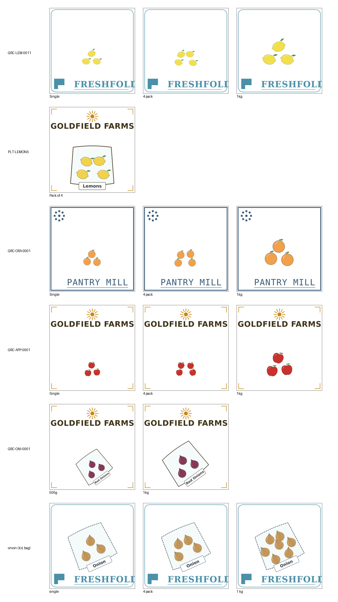

# Produce that fills its picture (gen#1111)

A pack of loose fruit or vegetables (`kit_produce.produce_pile`: loose, in a net or in a
clear bag) is drawn big, round and fresh. Each layout in `PILES` (1 to 7 fruits) gives its
fruits one size, and every fruit is scaled to the same painted area at that size whatever its
own shape's size, so a lemon and a grape fill the same space. Each fruit carries a gloss (a
radial highlight up-left and a shade down-right over its body), and the pile stands on a
`class="ground"` shadow. The bag and the net are enlarged round the bigger pile.

**Fill is measured against the product area**, the plain sheet's 344 x 334 box
(`house_styles.TURN_AREA`), and counts only the fruits (`<g class="fruit">`): a bag's film, a
net, a tag and the shadow do not count. `sheet_cover.cover` rasterizes the SVG on a grid and
returns the painted share of a box. A share of the whole 400 x 400 image cannot reach one half
for a round fruit once a house style frames it, so the contact sheets report both.

| shapes | floor | measured (counts 3-7, and 1-2 for a round body) |
|---|---|---|
| orange, lemon, apple, strawberry, tomato, onion, potato | 0.50 | 0.52 to 0.79 |
| banana, carrot, cherries | 0.25 (slice 3 raises it to 0.50) | 0.38 to 0.57 |

`tests/test_produce_fill_1111.py` pins the floors over every `FRUIT` x pack form x count, the
gloss on each fruit and the ground shadow. A banana, a carrot or a cherry pile needs its own
arrangement (a hand, a bunch, a heap) to fill a square, which slice 3 draws.

**What slice 1 does not change**: the served path still draws `fruit_count`'s 3 to 7 fruits
and shrinks a small pack by `pack_scale`, so a Single lemon is three fruits at 0.6 scale.
Slice 2 sets each SKU's form and count from its own pack (Single: one loose fruit; 4 pack:
four in a net; 1 kg: a bag) and stops shrinking produce by a count-to-grams ratio.

Served images (`image_release.render`), share of the whole image the fruit paints:

| SKU | before | after slice 1 |
|---|---|---|
| GRC-LEM-0011 Single / 4 pack / 1kg | 1.6% / 2.2% / 4.4% | 10.8% / 13.2% / 29.9% |
| GRC-ORA-0001 Single / 4 pack / 1kg | 1.9% / 2.5% / 5.1% | 12.8% / 14.5% / 35.3% |
| PLT-LEMONS (a bag of 4) | 4.9% | 30.5% |

Before:

After slice 1:

