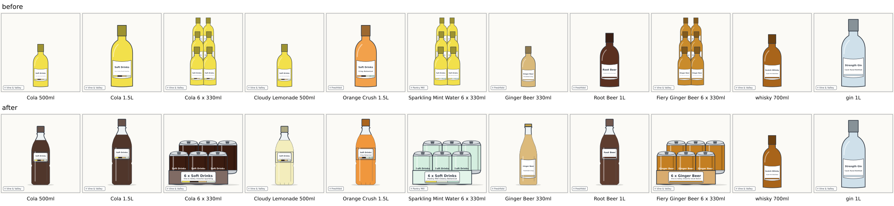

# Soft drinks drawn as their real can or bottle (gen#1127, slice 2)

Before gen#1127 every soft drink (the SFT soft drink lines and the GNB ginger beer and root
beer lines) shared the generic `bottle` shape, shrunk by `pack_scale` (gen#543). A 500ml
covered about a tenth of the product area, and a 6 x 330ml was six copies of that bottle. The
two families now draw `soft_drink` (`kit_soft_drinks.py`): 42 products, 354 SKUs. Wine is
slice 1 ([the wine bottle page](wine-bottles-1127.md)), beer, cider and perry slice 3 ([the beer page](beer-1127.md)). The hand-written ginger beer
(`PLT-GNGBER`) and root beer (`PLT-RTBEER`) draw `soft_drink` too, from their `net_volume_ml`
([the beer page's hand-written rows](beer-1127.md#hand-written-rows)).

The figure draws one product of each flavor and pack on the plain sheet, before and after. The
whisky and gin keep `bottle`, unchanged.

**The container is the pack's own.** Each SKU draws its own `pack_size` and `flavor` (per-SKU
drawing params), and `kit_soft_drinks.container` reads what that pack is sold in:

| pack | container |
|---|---|
| 500ml, 1L, 1.5L | a clear PET bottle: screw cap, neck ring, waist rib, petaloid foot, wrap label |
| 330ml in a ginger beer line (`grocery.SMALL_DRINK`, GNB) | a clear glass bottle with a crown cap |
| 330ml elsewhere | a ring-pull can |
| N x 330ml | N ring-pull cans in two rows under a card carrier |

Sizes are real (height, diameter) in mm (`kit_soft_drinks.DIMENSIONS`). A bottle's drink is its
flavor's color as poured (`LIQUIDS`: a cola dark, a cloudy lemonade pale), seen through the
clear wall; a can is printed in it. The elements carry classes: `bottle`, `can`, `drink`,
`cap`, `ring`, `foot`, `wrap`, `livery`, `carrier`, `shade` and `ground` (the shadow).

**The size.** A bottle follows the wine bottle's rule: the line's largest single (the `largest`
param, a multipack left out) spans `FULL_SHARE` 0.97 of the product area's height, and a smaller
one steps down by its real height ratio to the power `STEP_POWER`, never below `MIN_SHARE` 0.8
of it. A can is short and wide, so it is drawn at the full height, and a multipack's cans fill
the area's width. No `pack_scale` factor applies (`pack_scale.SELF_SIZED`), and the multipack
draws its own count, so `pack_copies` lays out no copies (`pack_copies.SELF_DRAWN_SHAPES`).

**Measured**: the cover of the product area (`house_styles.TURN_AREA`, `sheet_cover`, its ground
shadow left out) and the drawing's height span, as the wine page measures them.

| family | pack | before cover | after cover | after height span |
|---|---|---|---|---|
| SFT | 500ml | 0.105 | 0.183 | 0.86 |
| SFT | 1.5L | 0.220 | 0.224 | 0.97 |
| SFT | 6 x 330ml | 0.311 | 0.569 | |
| GNB | 330ml (glass) | 0.093 | 0.173 | 0.90 |
| GNB | 1L | 0.170 | 0.214 | 0.97 |
| GNB | 6 x 330ml | 0.311 | 0.569 | |

`tests/test_soft_drinks_1127.py` pins every soft drink SKU at no less cover than before and a
multipack of cans at 0.50 or more. It also pins the largest single's height span at 0.95 or
more and a smaller one's at 0.95 x 0.8, a multipack's count of cans with no copies, the 330ml
glass bottle in a ginger beer line and can elsewhere, each flavor's drink through the bottle,
and that a soft drink takes no `pack_scale` factor.
