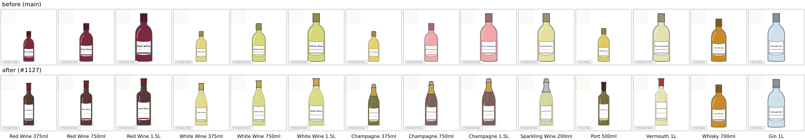

# Wine drawn as its real bottle (gen#1127, slice 1)

Before gen#1127 every wine, sparkling wine, port, sherry and vermouth shared the generic `bottle`
shape, shrunk by `pack_scale` (gen#543), so a half bottle stood at 0.63 of the frame's height
and covered about a tenth of the product area. These eight families (`grocery.WINE_STYLES`:
WRD, WWH, WRS, WSP, WCH, FPT, FSY, FVM) now draw `wine_bottle` (`kit_drinks.py`). Spirits and
mead keep `bottle`. Soft drinks draw `soft_drink` (slice 2, [the soft drinks page](soft-drinks-1127.md)),
beer, cider and perry draw `beer` (slice 3, [the beer page](beer-1127.md)). The two hand-written
red wines (`BRD-CW06`, `BRD-CW07`) draw `wine_bottle` too
([the one-size rows](beer-1127.md#one-size-rows)).
`grocery.py` imports `kit_drinks` with its other shape modules. A shape registers only when its
module is imported, so without that import `kit.SHAPES` lacked `wine_bottle` until a build drew
one, and the test that checks every family's shape failed depending on test order (gen#1142).

The figure draws one product of each family and size on the plain sheet, before and after; the
whisky and gin keep `bottle`, unchanged.

**The bottle is the style's own.** `kit_drinks.STYLES` gives each style a form, a glass and a
foil:

| style | form | glass |
|---|---|---|
| red, port, sherry | Bordeaux: high, square shoulders | green (port: dark) |
| vermouth | Bordeaux | flint |
| white, rosé | Burgundy: long sloping shoulders | flint |
| sparkling, Champagne | heavy sparkling bottle, mushroom cork under a wire cage | pale green (Champagne: dark) |

A form is a profile of `(height share, radius share)` points joined by a monotone cubic
(`_radius`, Fritsch-Carlson slopes), so a shoulder is one smooth curve that never overshoots a
point. The record's color is the wine's own. Below the fill line it is drawn through the glass
(`through_glass`: mixed with the glass's color by how much that glass hides), so a white in
flint glass shows its straw and a red in green glass shows dark. The elements carry classes:
`bottle` (the glass, and a sparkling bottle's cork), `wine`, `capsule` (the foil) and `ground`
(the shadow).

**The size is the bottle's own.** Each SKU draws its own `pack_size` (a per-SKU drawing param)
at that size's real height and diameter (`DIMENSIONS`, mm), so a magnum is stouter than a 750ml.
The line's largest size (the `largest` param) spans `FULL_SHARE` 0.97 of the product area's
height. A smaller size steps down by its real height ratio to the largest raised to
`STEP_POWER` 0.3, never below `MIN_SHARE` 0.8 of the largest. A real step (a 375ml is 0.7 of a
magnum's height) would leave the half bottle in a mostly empty frame again. No `pack_scale`
factor applies on top (`pack_scale.SELF_SIZED`, beside gen#1111's `produce_pile`).

**Measured**: the cover of the product area (`house_styles.TURN_AREA`, `sheet_cover`, step 2)
over every wine SKU of the grocery build.

| size | before (`bottle`) | after (`wine_bottle`) |
|---|---|---|
| 750ml | 0.169 to 0.269 | 0.172 to 0.204 |
| 500ml | 0.127 to 0.201 | 0.153 to 0.172 |
| 375ml | 0.104 to 0.169 | 0.149 to 0.178 |
| 200ml | 0.269 | 0.200 |
| 1L, 1.5L (a line's largest) | 0.269 | 0.194 to 0.236 |

A line's largest size, and a 200ml or 750ml that was its line's largest, cover less than
before. The generic bottle filled the frame's width as no real bottle does. A real bottle is
tall and narrow, and the drawing now keeps its proportions.

`tests/test_wine_bottle_1127.py` pins every wine SKU at 0.145 or more (a 750ml at 0.170). It
also pins the largest's height span at 0.95 or more of the area and a smaller size's at
0.95 x 0.8, the wine's color through the glass, the smooth shoulder, and that a spirit keeps
`bottle` and its `pack_scale` factor.
